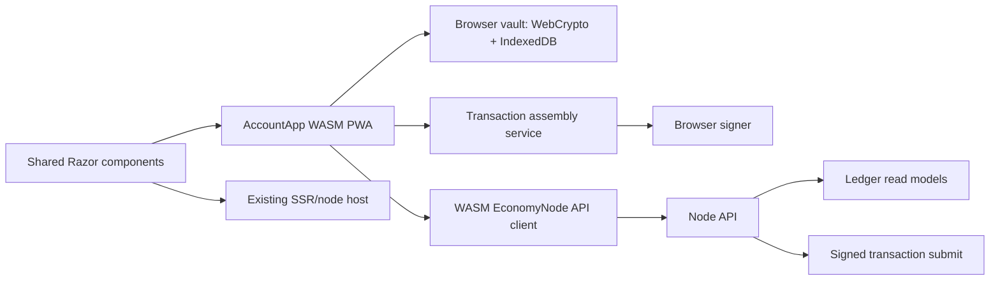

# Target Solution

## Boundary

- `AccountApp` is a Blazor WebAssembly PWA demo application.
- Browser owns account creation, private key encryption, IndexedDB persistence, unlock, transaction assembly, signing, and backup export/import.
- Node owns ledger read models and signed transaction acceptance only.
- Shared Razor components receive state/actions through host-neutral adapters rather than direct SSR session services.

## Target Layers

## Crypto Design Direction

- Introduce a small crypto-driver boundary that covers random bytes, SHA256, AES-GCM encryption/decryption, password KDF, ECDSA key generation/import/export/sign/verify, and signature format conversion.
- Provide a non-WASM implementation backed by existing .NET cryptography.
- Provide a WASM implementation backed by browser WebCrypto and JS interop.
- Keep browser vault storage as a separate service from signing and account-session state.
- Store only encrypted private key material and public metadata in IndexedDB.
- Require golden vectors that prove address derivation, encrypted backup round trips, and signature verification match between browser and .NET/node paths.

## API Design Direction

- Reuse `EconomyNodeLedgerClient` where feasible for read/broadcast contracts.
- Add or adapt an AccountApp SDK registration profile that configures `HttpClient` for browser use without storing node operator secrets.
- Confirm that these endpoints satisfy the required app flow:
  - `GET /api/v1/ledger/{ledgerId}/accounts/{address}/spendable-outputs`
  - `GET /api/v1/ledger/{ledgerId}/accounts/{address}/transactions`
  - `GET /api/v1/ledger/{ledgerId}/transactions/{txId}`
  - `GET /api/v1/transactions/{txId}`
  - `POST /api/v1/ledger/transactions`
- Decide whether AccountApp is served by the node host or a separate static host; implement CORS/PWA config accordingly in SB03/SB06.

## Transaction Design Direction

- Split transaction build into an unsigned draft/pre-sign phase and a signature application phase, or introduce a browser-backed signer that satisfies the existing builder without exposing raw keys outside the browser account session.
- Preserve existing canonical payload rules so node verification accepts browser-signed transactions.
- Prove that broadcast payloads are already signed and that node does not assemble/sign AccountApp transactions.

## UI Design Direction

- Reuse `EconomyAccountWorkspace`, transaction composer/history, UTXO explorer, and backup-related components after service decoupling.
- Create host-neutral interfaces for account workspace state and actions.
- Keep SSR demo sessions available for existing node/component demos.
- Add WASM adapters for account setup, browser vault, node API loading, and transaction broadcast.
- Use existing BaseLib layout components (`PageScaffold`, `Grid`, `Stack`, `FormRow`, forms) for new account setup panels where existing components are only visual placeholders.

## Testing And Proof Direction

- Unit tests: crypto vectors, backup import/export, transaction assembly, API contracts, SSR/WASM adapter boundaries.
- Browser tests: WebCrypto, IndexedDB persistence, wrong password/tamper rejection, create/import/backup/unlock flow, transaction list/detail loading, signed broadcast.
- Regression tests: SSR node console and component demo still work after component decoupling.
- Final proof: execution report with subbundle gates, browser analytics table, raw note closure, and workbook updates.
