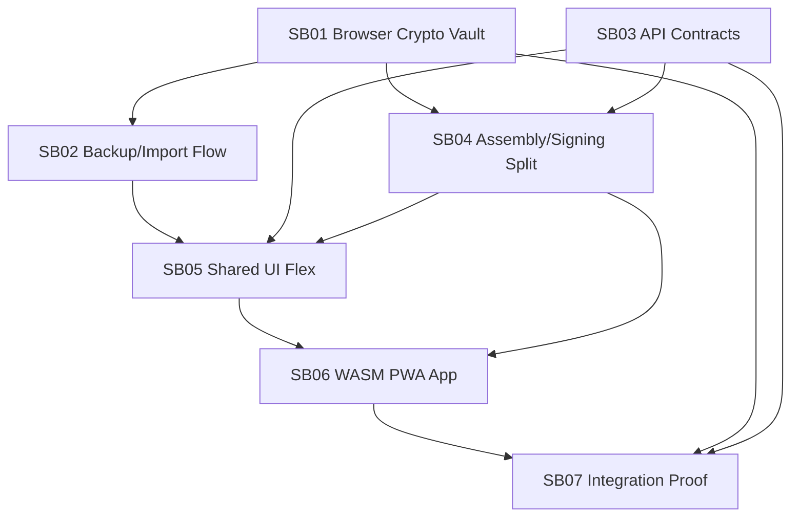

# Phase Plan

## Execution Order

1. SB01 Browser Crypto Vault
2. SB02 Account Backup Import Flow
3. SB03 API-Only Node Client Contracts
4. SB04 Transaction Assembly Signing Split
5. SB05 Shared UI SSR/WASM Flex
6. SB06 WASM PWA Demo App
7. SB07 Integration Browser Proof Hardening

## Subbundle Dependency Map

## Critical Subbundles

- SB01 is closed: WebCrypto, IndexedDB vault, and .NET compatibility vectors passed in `proof/SB01/manifest.md`; backup/import and browser signing work can now consume this foundation.
- SB02 is closed: account lifecycle and recovery are proven in `proof/SB02/manifest.md`; SB05 and SB06 may consume the service/component surface.
- SB03 is closed: AccountApp API-only read/broadcast contracts and browser-safe SDK registration are proven in `proof/SB03/manifest.md`; SB04 may proceed.
- SB04 is closed: unsigned transaction assembly, crypto-driver signing, ledger acceptance, browser WebCrypto POST, and no-private-key broadcast proof passed in `proof/SB04/manifest.md`.
- SB05 is closed: host-neutral adapters, WASM API/local-sign adapter behavior, SSR demo route, and SSR/WASM browser render proof passed in `proof/SB05/manifest.md`.
- SB06 is closed: AccountApp PWA project, browser launch, account lifecycle, API reads, transaction details, signed broadcast, backup/import, pasted-key import, manifest, service worker, and desktop/mobile proof passed in `proof/SB06/manifest.md`.
- SB07 is closed: no-key-leak storage/network audit, scoped builds, SSR regression build, workbook reconciliation, and completed-stage validator passed in `proof/SB07/manifest.md`.

## Phase Gates

| Gate | Required proof before moving on |
| --- | --- |
| G01 Crypto foundation | Passed in `proof/SB01/manifest.md`: WebCrypto/IndexedDB browser test, .NET compatibility tests, wrong-password and tamper-negative tests, no forbidden dependency audit. |
| G02 Account recovery | Passed in `proof/SB02/manifest.md`: create/unlock/backup/import round trip recovers the same address, rejects invalid backup/password, supports pasted-key import, and exposes host-neutral component callbacks. |
| G03 API-only contract | Passed in `proof/SB03/manifest.md`: AccountApp read/broadcast endpoints, browser-safe config, and no private-key request body proof. |
| G04 Browser signing | Passed in `proof/SB04/manifest.md`: browser-signed transaction verifies, submits through node API without server signing, and broadcast proof excludes private key fields/material. |
| G05 UI host neutrality | Passed in `proof/SB05/manifest.md`: shared components render through SSR and WASM host adapters, WASM adapter signs/broadcasts without node session, and desktop/tablet/mobile render proof passed. |
| G06 PWA route | Passed in `proof/SB06/manifest.md`: installable PWA shell, AccountApp flow wiring, clean browser launch, API data load, backup/import, and signed broadcast proof. |
| G07 Final closure | Passed in `proof/SB07/manifest.md`: execution report closes all raw notes, subbundle gates, browser analytics, and workbook checklist items with no-key-leak proof. |
