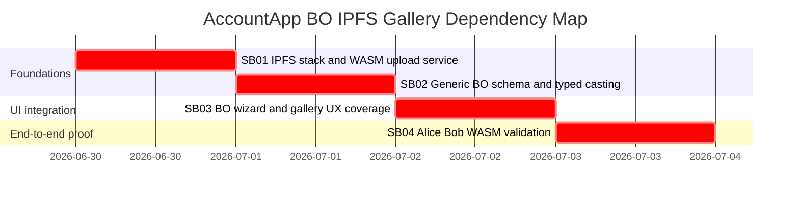

# Phase Plan

## Phase Sequence

1. SB01 starts/rebuilds IPFS and adds AccountApp WASM upload configuration/proxy/service.
2. SB02 adds the generic BO schema/catalog, builder/parser, typed views/casters, and unit tests.
3. SB03 connects the schema to wizard/gallery/details and proves all in-scope families render correct data.
4. SB04 rebuilds docker apps and performs Alice/Bob WASM validation with IPFS attachments and signed transactions.
5. Final closure audits raw notes, proof manifests, screenshots, and completed bundle validator output.

## Subbundle Dependency Map

## Critical Subbundles

- SB01 is a critical foundation because every attachment/image proof depends on the IPFS docker stack and WASM upload service.
- SB02 is a critical foundation because every "all generic BO types" proof depends on shared typed parsing/casting.
- SB03 is a critical UI foundation because browser proof depends on the wizard/gallery/detail UI using the shared schema.
- SB04 is a critical closure phase because it proves real Alice/Bob WASM behavior instead of fixture-only rendering.

## Phase Gates

- Gate after preparation: run `python C:/Users/dell/.codex/skills/candoitall-bundle-preparation/scripts/validate_bundle.py bundles/2026-06-30-accountapp-bo-ipfs-gallery --stage prepared`.
- Gate before SB01: confirm current docker stacks and IPFS compose file are readable.
- Gate after SB01: IPFS node and node-control are healthy; AccountApp build includes upload registration and nginx/appsettings proxy settings.
- Gate after SB02: focused tests prove all in-scope family aliases parse/cast and malformed payloads do not masquerade as typed data.
- Gate after SB03: component/browser proof shows all in-scope families have correct gallery/detail data.
- Gate after SB04: Playwright proof against docker AccountApps validates Alice/Bob create/send/refresh with at least one IPFS-backed image attachment.
- Gate before closure: run full relevant test project, docker health probes, anti-stub audit, completed bundle validator, and note-by-note closure audit.
