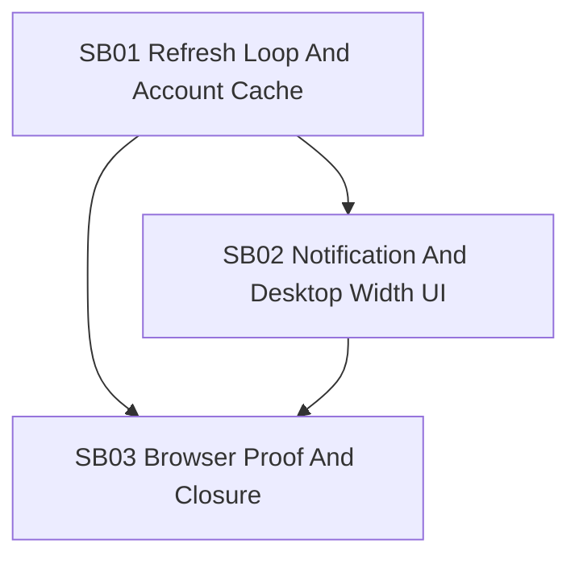

# Phase Plan

## Execution Order

1. SB01 Refresh Loop And Account Cache.
2. SB02 Notification And Desktop Width UI.
3. SB03 Browser Proof And Closure.

## Subbundle Dependency Map

## Critical Subbundles

- SB01 is critical because all later proof depends on the app seeing new ledger state without manual browser refresh.
- SB02 is critical because it changes visible UI behavior and desktop layout.
- SB03 is critical because it is the final cross-flow browser proof and raw-note closure gate.

## Phase Gates

| Gate | Required proof |
|---|---|
| Prepared gate | Bundle validator passes or records explicit validator limitations. |
| SB01 entry | Source references rechecked; existing tests fail or lack coverage for refresh probe/cache behavior. |
| SB01 closure | Tests cover unchanged fingerprint skip, changed fingerprint reload, transaction detail cache hit/miss, and disposal/cancellation safety. |
| SB02 closure | Tests or source assertions prove inline alerts are gone; CSS/source proof shows full-width unlocked app behavior. |
| SB03 closure | Docker apps rebuilt/restarted, tests pass, Playwright screenshots and DOM assertions prove refresh/UI behavior. |
