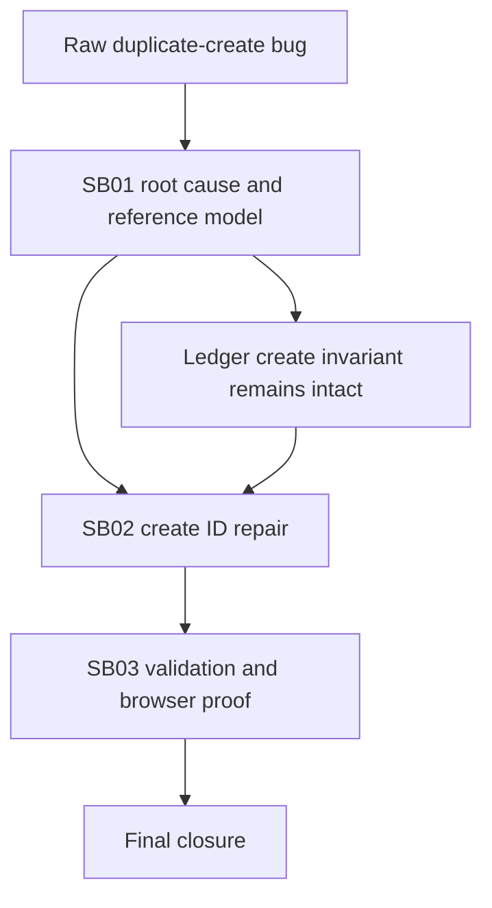

# Phase Plan

| Phase | Subbundle | Work | Gate |
|---|---|---|---|
| 1 | SB01 | Confirm root cause and reference identity model. | Analysis documents specific code path and external reference model. |
| 2 | SB02 | Add create ID helper, update wizard, add focused tests. | Focused .NET tests pass. |
| 3 | SB03 | Build and browser-validate duplicate-name create. | AccountApp build and Playwright proof pass. |

## Dependency Map

## Critical Foundations

- `SB01` is the critical foundation because an incorrect root cause would either weaken the ledger invariant or fix the wrong layer.
- `SB02` is behavior-changing and must prove same-name positive behavior and same-ID negative behavior.
- `SB03` is UI-critical because the reported bug was seen in the hosted AccountApp workflow.

## Reopen Triggers

- Reopen `SB01` if any later proof shows the transaction hash is duplicated or the builder normalizes IDs from payload name.
- Reopen `SB02` if any create path for interactive BOs bypasses `BusinessObjectCreateIdFactory`.
- Reopen `SB03` if browser proof cannot create two same-title image BOs or if `already exists` appears in the UI after the second create.
