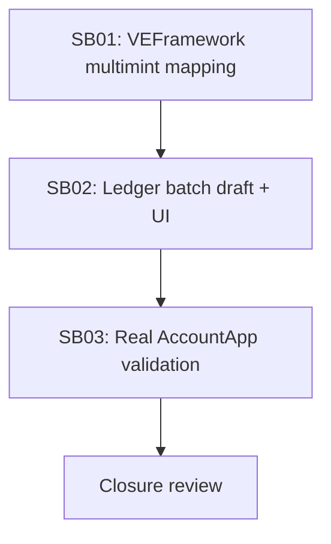

# Phase Plan

## Phase Sequence

1. Map VEFramework multimint behavior and confirm Ledger integration boundaries.
2. Implement batch draft model/event, wizard multimint UI, adapter host batch submission, and SSR ownership alignment.
3. Add focused tests for draft generation, recipient resolution, and batch host submission.
4. Rebuild/start services if needed and validate with a real AccountApp batch of 5 tickets.
5. Capture screenshots, ledger/API evidence, and closure review.

## Subbundle Dependency Map

## Critical Subbundles

- SB01 is critical because it defines which VEFramework behavior is semantic versus implementation detail.
- SB02 is critical because it touches create ownership, object identity, and adapter submission.
- SB03 is critical because batch minting must be proven with real browser and ledger state, not just component rendering.

## Phase Gates

- Gate after preparation: run `validate_bundle.py --stage prepared`.
- Gate before SB02: confirm current wizard/adapters and source ownership semantics.
- Gate after SB02: run focused .NET tests before browser proof.
- Gate after SB03: attach screenshots and ledger/API proof manifest.
- Gate before closure: run bundle validator, tests, and update execution report.
