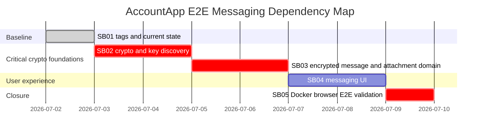

# Phase Plan

## Phase Sequence

1. SB01 removes `Neblio` defaults and records current-state/source proof.
2. SB02 implements and proves signer public-key discovery plus WebCrypto ECDH compatibility.
3. SB03 implements secure message/attachment BO domain, encrypted IPFS upload, and lazy decrypt services.
4. SB04 implements large-screen mailbox/compose/detail UI around the secure domain.
5. SB05 rebuilds Docker and proves Alice/Bob E2E messages both directions, with and without attachments.

## Subbundle Dependency Map

## Critical Subbundles

- SB02 is critical because every secure message depends on real public-key discovery and browser ECDH.
- SB03 is critical because UI proof is meaningless if body or attachment bytes are still plaintext.
- SB05 is critical because the user explicitly requires Docker WASM Alice/Bob validation.

## Phase Gates

- Prepared gate: run `python scripts/validate_bundle.py --stage prepared` from bundle root.
- SB01 gate: source search shows production default tags no longer include `Neblio`; exact changed files and hashes recorded.
- SB02 gate: failing-first proof rejects no-key/mismatched-key discovery and browser ECDH absence; passing proof shows .NET/browser ECDH compatibility and signed tx public key preservation.
- SB03 gate: tests prove plaintext is absent from BO state/IPFS bytes and message/attachment decrypt only on explicit calls.
- SB04 gate: Playwright large-screen proof shows mailbox/compose/open/decrypt attachment states with no layout overflow and no list bulk decryption.
- SB05 gate: Docker images rebuilt/recreated; Alice to Bob and Bob to Alice secure messages pass with and without attachments; final bundle validator passes completed stage.

## Reopen Policy

- Reopen SB02 if any later phase accepts an untrusted key or derives incompatible keys.
- Reopen SB03 if any later phase finds plaintext in ledger/IPFS storage or eager decryption.
- Reopen SB04 if browser screenshots show poor large-screen space use, confusing BO-first terminology, overlay clipping, or hidden controls.
