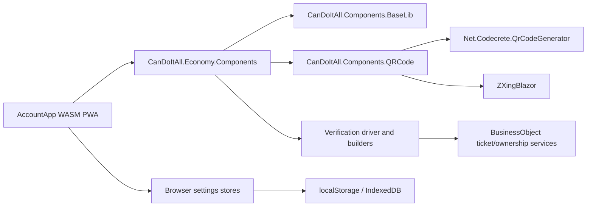

# Target Solution

## Architecture Overview

## Component Boundaries

- `CanDoItAll.Components.QRCode`: new shared component project in the sibling components repository. It owns QR rendering, QR dialog shell, QR action button, scan dialog, scan button, payload contracts, and package references for generation/scanning.
- `CanDoItAll.Economy.Components`: consumes QR components and owns ledger-specific payload semantics for addresses, transaction hashes, BO ownership hashes, ticket verification, and recipient selection.
- `CanDoItAll.Economy.AccountApp`: owns browser shell composition, session notifications, PWA-specific browser storage registration, and settings backup/import/export.
- `CanDoItAll.Components.BaseLib`: remains the source for dialog shell, toolbar, action button, tooltip, notification, tag editor, badge, picker, and layout primitives.

## Shell Design

- Replace the separate unlocked-vault card, account info card, and action row with one sticky workspace command strip.
- Use the command strip for account name, avatar/icon, compact address, endpoint/environment state, signing state, and primary icon actions.
- Convert unlock/create/import success text to `NotificationService` messages.
- Keep error/failure states visible and actionable, but avoid persistent success cards.
- Keep page body focused on the economy workspace and avoid pushing the workspace below administrative cards.

## QR Design

- Generation contract:
  - `QrPayloadKind`: address, subaddress, transaction hash, BO ownership hash, ticket ownership hash, generic text.
  - `QrCodeButton`: icon action with tooltip and optional copied payload display.
  - `QrCodeDialog`: dialog that displays QR SVG, payload metadata, copy action, and optional download.
  - `IQrCodeRenderer`: service wrapper around `Net.Codecrete.QrCodeGenerator`.
- Reader contract:
  - `QrScanButton`: icon action with tooltip.
  - `QrScanDialog`: scanner shell using ZXingBlazor and fallback paste/manual entry.
  - `QrScanResult`: decoded text, kind detection, confidence/source, and validation errors.
- Ledger-specific adapters parse payloads into receiver address, tx hash, BO hash, or verification request models.

## Tag Design

- `IAccountTagOccurrenceStore` stores tag statistics per account.
- Tag keys include normalized tag text, account address, optional token/type scope, and BO identity.
- Counters:
  - `GeneralCount`: increments whenever details for a BO with a tag are opened.
  - `UniqueBusinessObjectCount`: increments only once per BO/tag/account combination.
- `TagSuggestionMode`: `UniqueBusinessObjects`, `GeneralOpenCount`, or `ManualPinned`.
- `TagVisualMetadata`: stable color token, foreground color token, created/updated timestamps, optional pinned flag.
- UI uses BaseLib `TagEditor` for entry and BaseLib `Badge`/`StatusBadge` for display.

## Address Directory Design

- `AddressDirectoryEntry`: address, display name, kind (`External`, `OwnSubaccount`), profile BO cache reference, avatar/icon metadata, favorite flag, user tags, last seen, source, and notes.
- `IAddressDirectoryStore`: local browser persistence, import/export support, seed/update from transactions and subaccounts.
- `AddressDirectoryDialog`: generic component with manage/select mode, card grid, search, tag filters, favorites, profile preview, and own/external filters.
- Integration targets: home address management, send transaction receiver, BO send/mint receiver, gallery owner selection, and subaccount selection.

## Settings Backup Design

- `IAccountAppSettingsStore` enumerates browser settings owned by AccountApp and shared economy components.
- `IAccountSettingsBackupService` exports/imports tagged sections:
  - UI preferences.
  - Tag occurrence and tag color metadata.
  - Address directory entries.
  - Cached profile BO summaries.
  - Account workspace cache metadata where safe.
- Import flow uses preview, section selection, conflict strategy, and confirmation before write.

## Verification Driver Design

- `VerificationFlowBuilder` composes typed steps.
- Core steps:
  - Decode QR/manual payload.
  - Resolve target BO or transaction hash.
  - Verify signed ownership hash.
  - Verify BO type and expected issuer/address.
  - Verify ticket Used flag when configured.
  - Optionally write Used state after confirmation.
- Output includes step results, evidence payload, errors, and next action hints. Tickets use the same driver with extra ticket-specific steps.

## Testing And Proof Strategy

- Unit/service tests for QR payload parsing, tag occurrence counting, address directory persistence, settings import/export, and verification driver positive/negative cases.
- Blazor component tests where practical for dialog contracts.
- Large-screen Playwright proof for shell, dialogs, tooltips, QR generation, address manager, backup dialog, and verification flows.
- Screenshot review must explicitly answer available-space use, scroll reduction, overflow, overlays, dialog fit, and component consistency.
