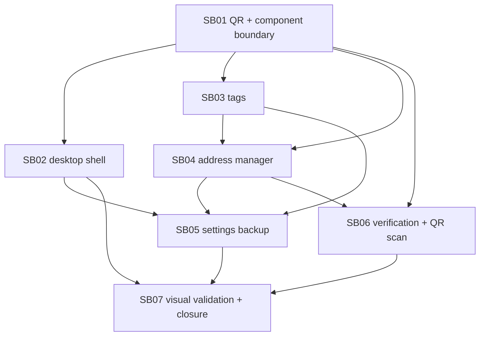

# Phase Plan

## Execution Order

1. SB01 shared component boundary and QR foundation.
2. SB02 desktop AccountApp shell and top toolbar polish.
3. SB03 tag occurrence service and shared tag rendering.
4. SB04 generic address manager dialog for bookmarks and subaccounts.
5. SB05 browser settings backup/import/export.
6. SB06 verification driver, QR scan, and ticket ownership flows.
7. SB07 large-screen browser validation and closure.

## Subbundle Dependency Map

## Critical Subbundles

- SB01 is the foundation for QR generation/scanning and shared component boundaries. Downstream QR, verification, and dialog flows must not proceed if this gate fails.
- SB02 is the visible shell correction requested by the screenshot. Downstream screenshots must compare against the old card stack and verify workspace lift.
- SB03 owns semantic tag counters and color persistence; address manager and settings backup depend on its storage model.
- SB04 owns the generic address directory model; transaction, minting, gallery, and subaccount selectors depend on it.
- SB06 owns ownership/ticket verification semantics. It requires source-backed tests, not screenshot-only proof.
- SB07 is the final closure gate. It cannot pass until workbook, execution report, screenshots, and tests are synchronized.

## Phase Gates

| Gate | Required Proof | Blocks |
| --- | --- | --- |
| QR foundation | WASM build proof, shared project compiles, QR dialog renders payload, scanner abstraction compiles. | SB02, SB06 |
| Shell polish | Screenshot shows top card stack removed and workspace visible higher; notifications replace success cards. | SB05, SB07 |
| Tag semantics | Tests prove general and unique counters, persisted colors, and contrast selection. | SB04, SB05, SB07 |
| Address directory | Generic dialog supports manage/select, own/external, favorites, tags, and profile cache. | SB05, SB06, SB07 |
| Settings backup | Export/import preview and restore tests pass for settings sections. | SB07 |
| Verification | Positive/negative ownership and ticket Used-state tests pass; QR scan/generate routes are wired. | SB07 |
| Visual closure | Large-screen screenshots, screenshot review, no overflow/overlay, and build/tests complete. | Final closure |

## Workbook

- Detailed checklists and references are maintained in `plan/accountapp-ui-shared-components-plan.xlsx`.
- Workbook previews are rendered to `proof/workbook-previews/` when regenerated.
