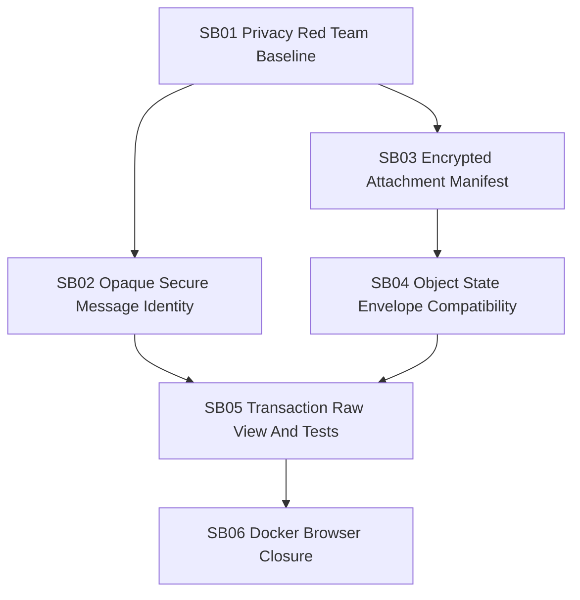

# Phase Plan

## Execution Order

1. `SB01 Privacy Red Team Baseline`
2. `SB02 Opaque Secure Message Identity`
3. `SB03 Encrypted Attachment Manifest`
4. `SB04 Object State Envelope Compatibility`
5. `SB05 Transaction Raw View And Tests`
6. `SB06 Docker Browser Closure`

## Subbundle Dependency Map

## Critical Subbundles

- `SB01` is critical because it converts the user raw tx complaint into executable privacy assertions.
- `SB03` is critical because it changes the message/attachment crypto data contract.
- `SB04` is critical because projection compatibility protects all BO apps, not just messaging.
- `SB06` is critical because the user explicitly required Docker WASM proof.

## Phase Gates

| Gate | Required Proof |
| --- | --- |
| Prepared | Bundle docs, requirements, dependency map, subbundle contracts, XLSX impact map, validation script pass |
| SB01 closure | Failing-first test proves current leakage or test is committed with implementation-specific pass proof |
| SB02 closure | Secure-message object id/external ref privacy test passes |
| SB03 closure | New messages hide attachment locators and both participants decrypt attachments |
| SB04 closure | Legacy and object-valued envelopes parse in in-memory and node read paths |
| SB05 closure | Raw tx component test shows structured nested state and no escaped secure-message content surprise |
| SB06 closure | Docker compose build/up, health check, Alice/Bob messaging validation, browser screenshot |
