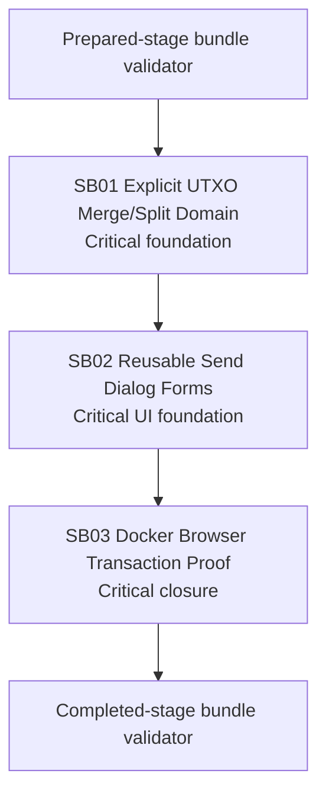

# Phase Plan

## Phase Sequence

1. SB01 adds and proves explicit UTXO merge/split transaction assembly and submission across account adapters.
2. SB02 extracts reusable Send, Merge, and Split dialog form components and binds them to workspace spendable outputs.
3. SB03 rebuilds/restarts docker, creates or uses enough UTXOs, submits Send/Merge/Split through the UI, opens transaction details, captures screenshots, and closes raw notes.

## Subbundle Dependency Map

## Critical Subbundles

- SB01 is critical because UI proof is meaningless if transaction assembly spends the wrong UTXOs or includes disallowed outputs. It requires failing-first/positive domain proof, source assertions, anti-stub audit, and a manifest.
- SB02 is critical because the raw request explicitly requires reusable isolated forms and correct large-dialog behavior. It requires component proof, browser screenshot proof, source assertions, anti-stub audit, and a manifest.
- SB03 is critical closure because the raw request requires docker rebuild/restart, UI testing of all types, screenshots, and proof in transactions.

## Phase Gates

- Gate after preparation: run `python C:/Users/dell/.codex/skills/candoitall-bundle-preparation/scripts/validate_bundle.py bundles/2026-07-04-accountapp-utxo-merge-split --stage prepared --profile feedback --repo-root .`.
- SB01 entry gate: source references still match repo and no existing explicit UTXO merge/split request model exists.
- SB01 progression gate: targeted tests prove vin/vout semantics and disallowed-output rejection, and `proof/SB01/manifest.md` plus semantic invariants exist.
- SB02 entry gate: SB01 is completed and its proof is trusted.
- SB02 progression gate: reusable components are source-proven, component tests pass, and first large-screen dialog screenshot is acceptable.
- SB03 entry gate: SB01 and SB02 are completed and docker compose file is available.
- SB03 closure gate: docker stack rebuild/restart transcript exists, UI submits Send/Merge/Split, transaction details prove real vin/vout counts, screenshots are reviewed, raw notes are closed, and completed-stage validator passes.
