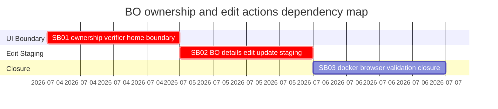

# Phase Plan

## Phase Sequence

1. SB01 removes the BO Actions verifier scanner while preserving Home ownership verification.
2. SB02 adds BO details edit/update staging through the existing minting wizard form.
3. SB03 runs final tests, Docker rebuilds, browser proof, raw-note closure, and completed-stage validation.

## Subbundle Dependency Map

- SB02 depends on SB01 because BO details action layout changes must not reintroduce the ownership scanner while adding Edit.
- SB03 depends on both behavior subbundles because Docker/browser closure must test the final integrated UI.

## Critical Subbundles

- SB01 is a Critical UI foundation. It requires semantic proof that scanner verification remains Home-only and absent from BO details.
- SB02 is a Critical UI and transaction foundation. It requires semantic proof that the edit flow reuses the minting wizard form and stages an update transaction for the selected BO.
- SB03 is a final closure subbundle. It requires verifier proof across tests, Docker, browser screenshots, and raw-note closure.

## Phase Gates

- Gate after preparation: run `python bundles/2026-07-04-bo-ownership-home-edit-actions/scripts/validate_bundle.py bundles/2026-07-04-bo-ownership-home-edit-actions --stage prepared --profile feedback --repo-root .` and repair failures.
- Gate before SB01: confirm the source references still show the verifier action in BO details and Home `MessageSecurityPanel` ownership verifier.
- Gate after SB01: component/source proof must show BO details has no scanner action and Home scanner still exists before SB02 starts.
- Gate before SB02: confirm SB01 closure proof is trusted and no scanner was reintroduced in the BO details action area.
- Gate after SB02: component/source proof must show edit opens the reused wizard and stages update-mode draft before Docker/browser closure starts.
- Gate before closure: run targeted tests, broader tests/builds, Docker rebuilds, Playwright proof, anti-stub audits, proof manifests, and `--stage completed` validation.
