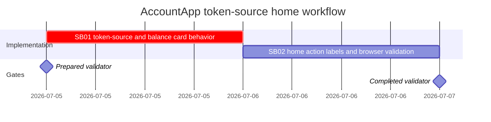

# Phase Plan

## Phase Sequence

1. SB01 implements the token-source predicate and balances-card consolidation, then proves the domain semantics with component tests and source assertions.
2. SB02 implements visible home action labels, verifies the top-frame icon-only constraint, runs build/browser validation, and closes raw notes.
3. Final closure updates proof manifests, execution report rows, raw note statuses, and validator transcripts.

## Subbundle Dependency Map

- SB02 depends on SB01 because browser proof of the compact home layout is meaningful only after the separate Token Sources card is removed.
- The completed validator depends on SB01 semantic proof and SB02 browser/build proof.

## Critical Subbundles

- SB01 is a critical UI/domain foundation: it defines what counts as a token source and prevents unique one-amount or BO-backed tokens from being misrepresented.
- SB01 requires Semantic Adequacy Gate proof: raw note owned, shipped behavior, source proof, test proof, shallow-pass trap, adversarial negative proof, semantic positive proof, anti-stub audit, and raw-note literal closure.
- SB01 requires `proof/SB01/manifest.md` and `proof/SB01/semantic-invariants.md` with changed-file hashes, command transcripts, source assertions, failing-first or negative proof, passing proof, anti-stub audit, and downstream smoke/browser dependency notes.

## Phase Gates

- Preparation gate: `python C:\Users\dell\.codex\skills\candoitall-bundle-preparation\scripts\validate_bundle.py bundles/2026-07-05-accountapp-token-source-home-actions --profile feedback --stage prepared --repo-root .` passes.
- SB01 entry gate: raw request, normalized requirements, source references, and current-state analysis are complete.
- SB01 closure gate: token-source component tests pass, source assertions prove the predicate, changed-file hashes are recorded, and SB02 may start only if the Balances panel owns real token-source display.
- SB02 entry gate: SB01 closure gate has passed or has an explicit blocker accepted in the execution report.
- SB02 closure gate: home action labels are visible, top-frame actions remain icon-only, AccountApp build passes, browser analytics and screenshot review are recorded or an explicit browser blocker is logged.
- Final closure gate: completed-stage validator passes, raw notes are closed as Solved or explicitly partial, and residual risks are represented as blockers or follow-up items.
