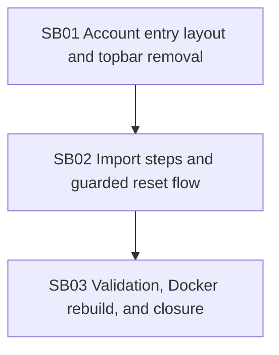

# Phase Plan

## Phase Sequence

1. Prepare and validate this bundle.
2. Execute `SB01` for top-bar removal and large-screen account-entry layout foundation.
3. Execute `SB02` for import steps and guarded local-vault reset.
4. Execute `SB03` for tests, AccountApp build, Playwright proof, docker rebuild, and final closure audit.

## Subbundle Dependency Map

## Critical Subbundles

- `SB01` is a critical UI foundation because all browser visual proof depends on the top-bar removal and account-entry layout baseline.
- `SB02` is a critical behavior/UI foundation because it changes destructive local-vault reset behavior and import progression.
- The validation and Docker closure workstream must verify SB01/SB02 proof rather than adding new product scope.

## Phase Gates

- Gate after preparation: run the bundle validator and repair failures.
- Gate before each subbundle: confirm prerequisites are complete and still valid.
- Gate after each subbundle: capture proof, review screenshots, and decide whether downstream work may continue.
- Gate before closure: rerun validators, close raw notes, and reopen anything with weak proof.

| Gate | Required proof before proceeding |
| --- | --- |
| `SB01 -> SB02` | Source assertion shows no unlocked `account-app__workspace-frame`; large-screen locked and unlocked markup renders without compile errors; AccountApp build or targeted test passes. |
| `SB02 -> SB03` | Import source contains BaseLib `Steps`/`StepsItem`; reset cannot enable without acknowledgement and typed `RESET LOCAL VAULT`; targeted tests pass for reset/session and markup source assertions. |
| `SB03 -> closure` | AccountApp build, targeted tests, Playwright large-screen screenshots/assertions, docker compose build, completed-stage validator, and final raw-note closure all pass or record a concrete blocker. |
