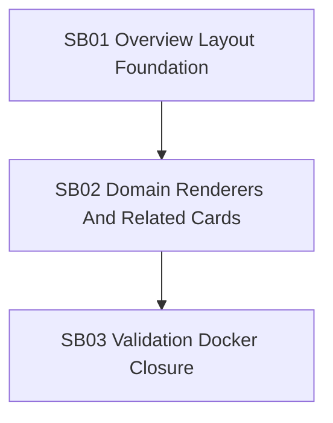

# Phase Plan

## Execution Order

1. `SB01 Overview Layout Foundation`
2. `SB02 Domain Renderers And Related Cards`
3. `SB03 Validation Docker Closure`

## Subbundle Dependency Map

## Critical Subbundles

| Subbundle | Critical foundation? | Why |
|---|---|---|
| `SB01` | Yes | Shared gallery-card extraction and adaptive overview branching must be correct before related-card/domain layouts can trust it. |
| `SB02` | Yes | Domain renderer and relationship resolution determine whether event/ticket/commerce BOs satisfy the main request. |
| `SB03` | Yes | Browser/docker proof is required by the user and is the only reliable visual proof against the proposal. |

## Phase Gates

| Phase | Entry criteria | Exit criteria | Reopen trigger |
|---|---|---|---|
| `SB01` | Bundle prepared; source references valid. | Gallery card is reusable; empty DataItems overview hides gallery hero; media path remains intact; focused tests pass. | Gallery card duplicates remain or media path loses preview behavior. |
| `SB02` | `SB01` closure proof exists. | Event/ticket/commerce facts and related BO cards render; renderer providers registered and tested. | Related cards cannot resolve current workspace BOs or provider priority breaks rule/settings renderers. |
| `SB03` | `SB02` tests/build pass. | Large-screen browser screenshots captured, compared to proposal, dockered apps rebuilt and opened successfully, execution report updated. | Screenshot still shows empty gallery hero for no-DataItems BO or docker app fails to serve rebuilt UI. |

