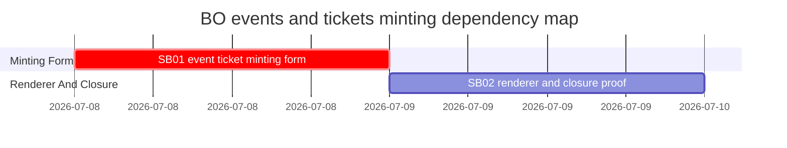

# Phase Plan

## Phase Sequence

1. SB01 replaces the generic event/ticket field loop with domain-specific event/ticket mint controls and create-flow mint author autofill.
2. SB02 verifies detail rendering and closes final proof across tests, source assertions, anti-stub audit, browser validation or explicit blocker, and raw-note closure.

## Subbundle Dependency Map

- SB02 depends on SB01 because renderer proof and browser validation must inspect the final fields created by the improved minting flow.

## Critical Subbundles

- SB01 is a Critical UI/data foundation. It requires semantic proof that domain fields use date-time and dropdown controls and that `mintAuthorAddress` is populated from the minting workspace address.
- SB02 is final closure. It verifies details remain correct and records final proof, including a browser validation row or an explicit validation blocker.

## Phase Gates

- Gate after preparation: run `python bundles/2026-07-08-bo-events-tickets-minting/scripts/validate_bundle.py bundles/2026-07-08-bo-events-tickets-minting --stage prepared --profile feedback --repo-root .` and repair failures.
- Gate before SB01: confirm source references still show the generic typed-field loop in `BusinessObjectCreationWizard.razor` and current event/ticket field definitions in `BusinessObjectFamilyCatalog.cs`.
- Gate after SB01: targeted bUnit tests and source assertions must prove date-time controls, dropdown categories, preserved ticket event/multimint flow, and mint author autofill before SB02 starts.
- Gate before SB02: SB01 proof must be trusted and no event/ticket field behavior remains only cosmetic.
- Gate after SB02: detail rendering proof, targeted tests, build/test proof, anti-stub audit, browser validation or explicit blocker, raw-note closure, proof manifests, and completed-stage validation must pass.
