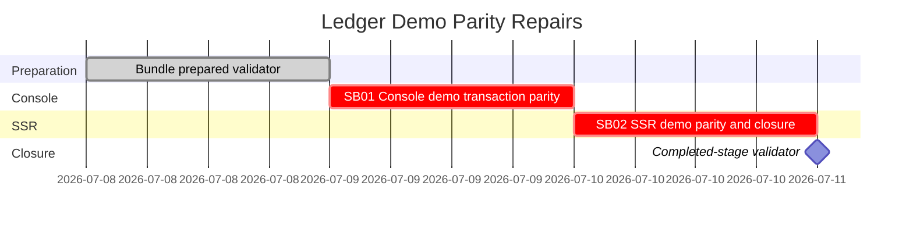

# Phase Plan

## Execution Order

1. Run prepared-stage validation and repair the bundle before implementation.
2. Execute SB01 console demo parity with failing-first tests, implementation, and proof.
3. Execute SB02 SSR demo parity and final closure with failing-first tests, implementation, proof, and completed-stage validation.

## Subbundle Dependency Map

- SB02 depends on SB01 source assertions that console code uses shared APIs, not demo-local transaction assembly.
- Final closure depends on both critical proof manifests and semantic invariant contracts.

## Critical Subbundles

- `SB01` is critical because console parity is one of the two requested app surfaces and its proof establishes how non-WASM demos should call shared transaction APIs.
- `SB02` is critical because SSR demo parity is the other requested app surface and it owns final raw-note closure.

## Phase Gates

- Prepared gate: run `python bundles/2026-07-08-ledger-demo-parity-repairs/scripts/validate_bundle.py --stage prepared --bundle-root bundles/2026-07-08-ledger-demo-parity-repairs`.
- SB01 entry gate: root bundle prepared, source references still exist, CodeAnalytics gap recorded, no unrelated user-owned changes reverted.
- SB01 closure gate: failing-first and passing tests captured; source assertions, anti-stub audit, hashes, manifest, and semantic invariants exist.
- SB02 entry gate: SB01 closed; SSR source references still exist; browser-proof need reassessed from actual change surface.
- SB02 closure gate: SSR tests/build/source proof captured; final execution report and raw note closure populated; completed-stage validator passes.
