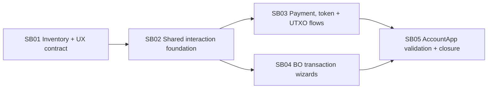

# Phase Plan

## Subbundle Dependency Map

## Critical Subbundles

- SB02 is the critical architecture/UI foundation. Weak catalog, validation, or selection contracts invalidate all later flows.
- SB04 is critical for the literal clone/BO wizard request and hidden supported modes.
- SB05 is critical final proof because the user requires all forms to work in AccountApp WASM.

## Phase Gates

- SB01 -> SB02: inventory enumerates all twelve enum values, baseline screenshots exist for all nine current forms, and imagegen proposal coverage has no unmapped form/step.
- SB02 -> SB03/SB04: catalog coverage, validation negative/positive tests, BO selector tests, no-partial audit, and shell composition smoke pass.
- SB03 -> SB05: Payment/Token/UTXO valid and invalid component tests pass without regressing UTXO domain tests.
- SB04 -> SB05: Create/Transfer/Update/Close/Clone/Merge/Split Payment valid and invalid component tests pass; clone has all three source strategies.
- SB05 closure: rebuilt AccountApp passes every flow at desktop plus responsive geometry checks, final tests/build pass, and all raw notes close literally.

## Execution Order

1. SB01
2. SB02
3. SB03 and SB04 after SB02, executed one at a time
4. SB05

## Reopen Policy

- Reopen SB02 if later flows need copied shell, validation, or selection markup.
- Reopen SB03/SB04 if browser proof exposes invalid submit readiness.
- Rebuild the prepared-stage bundle if a mode is excluded or delegated differently than this plan.

