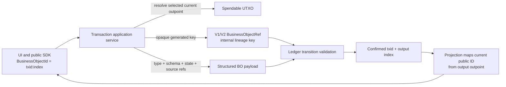

# BusinessObject UTXO Identity: Target Solution

## Invariants

1. A public `BusinessObjectId` is exactly `BusinessObjectId.FromOutPoint(currentOutPoint)` and serializes as `txid:outputIndex`.
2. Creating, cloning, or merging never accepts a target BO ID. The UI says that identity is assigned after confirmation.
3. Every newly confirmed BO output receives its public ID from the confirmed transaction ID and output index.
4. An update or transfer creates a new current BO ID. The previous ID remains an immutable source reference.
5. BO type and schema are present in the structured BO data envelope; display name remains inside state data.
6. Clone and merge payloads contain typed source references using canonical UTXO BO IDs.
7. The stable V1/V2 wire correlation value is an internal `BusinessObjectLineageKey`, not a BO ID. It is never accepted from or shown to end users for generic BO creation.
8. Commerce, permission, rule, simulator, and batch flows follow the same rule; logical names and correlations live in state data or external references, never in a public BO ID.

## Compatibility architecture



The V1/V2 canonical JSON field remains named `ObjectId` solely to preserve historic hashes, but its domain type and code-facing name become `BusinessObjectLineageKey`. A future V3 wire format may remove that compatibility field once output-to-source correlation is fully encoded by protocol data. Every public field named `ObjectId` is outpoint-derived. Public transaction-read DTOs omit lineage; spendable execution DTOs may carry the V1/V2 correlation as a separately named `LineageKey` alongside—and never instead of—the canonical `ObjectId`.

## Payload contract

Structured BO data has this logical shape:

```json
{
  "objectType": "post",
  "schemaVersion": "1.0",
  "stateJson": {},
  "references": [
    { "relationship": "clone-source", "objectId": "<txid>:<index>" }
  ]
}
```

References are optional for root creates and required for clone/merge. Readers remain backward-compatible with existing envelopes that have no `references` property or encode `stateJson` as a string.

## Ownership

- Core owns `BusinessObjectId` outpoint conversion, the internal lineage-key value type, and the structured payload envelope contract/reader required by inward protocol validation.
- BusinessObjects owns opaque lineage-key generation, structured payload construction/writing, and request semantics.
- Ledger continues to validate V1/V2 correlation via lineage keys; it does not invent public IDs. An update or transfer must bind its canonical `previous-version` reference to the consumed BO with the same internal lineage as the produced BO.
- Persistence stores legacy correlation values for replay but derives public IDs at projection/read boundaries.
- Node maps internal summaries to explicit public transaction/spendable DTOs. SDK mappings validate that each public BO ID equals its containing transaction/output or spendable outpoint before reconstructing any internal protocol reference.
- Components never generate or edit a target BO ID.
- Transaction UI models carry only BO version/operation/hash metadata. Input IDs come from the consumed outpoint and output IDs come from the containing transaction ID plus output index.

## Migration behavior

- Existing transactions replay byte-for-byte because V1/V2 canonical property names and values are unchanged.
- Existing DB rows need no destructive rewrite; their stored `BusinessObjectId` values are treated as legacy lineage keys.
- Existing current records immediately expose `CurrentOutPoint` as their canonical BO ID.
- New generic root/clone/merge lineages use opaque random keys that contain no type or name.
- History starts from a canonical public ID and follows structured `previous-version` references. Trusted in-process summaries may use internal lineage as a compatibility fallback; public transaction summaries do not require or expose it, and no public query accepts lineage as identity.

## Compatibility surfaces

The V1/V2 serialized property name `ObjectId` cannot be renamed without changing historical hashes. Code now types that value as `BusinessObjectLineageKey`; the old `BusinessObjectRef.ObjectId` alias and request constructors that accepted caller-selected create/clone/merge IDs are marked obsolete. They exist only for source migration and are not used by production UI, Node, console, simulator, or commerce paths.

Legacy authority and commerce ID factories are also obsolete wrappers. Their replacements are explicit lineage-key APIs where historical protocol fixtures still need them; confirmed receipts and UI results always expose output-derived IDs.

The legacy Node mint/transfer request keeps its historical `businessObjectId` marker for V1/V2 callers, but treats it only as a compatibility signal and generates opaque internal lineage. It has no production UI/CLI caller and never becomes a public ID. V3 should remove or rename that marker and require the structured type/schema envelope for every newly created BO.
