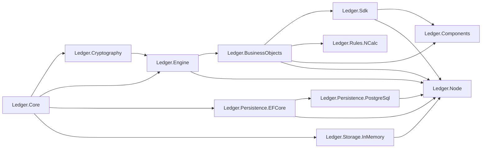

# C# Dependency Direction

## Current And Target Graph

The target graph is exactly the current `.csproj` graph after applying the
project rename map in `inventories/01-scope-inventory.md`. No edge is added,
removed, or reversed.

## Forbidden References

- Core to Engine/Node/UI/persistence.
- Engine to BusinessObjects/SDK/Node/UI/persistence.
- Abstractions to `Simulation.Ledger`.
- Any new cycle or sibling source dependency beyond the pre-existing explicit
  Components/IPFS solution/demo references.

## Required Proof

- Normalize each pre/post `ProjectReference` through the rename map and compare.
- Build the canonical solution.
- Rerun CodeAnalytics dependencies if the MCP health recovers; otherwise record
  manual graph plus build evidence in the architecture review gate.
