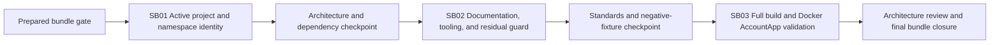

# Phase Plan

## Phase Sequence

1. Validate SB01 entry, execute the atomic active identity migration, run
   dependency/architecture/build/test proof, and close the critical foundation.
2. Validate SB02 entry, update current docs and repository-owned validation,
   apply the relevant SharedInfo standards, and prove the residual guard.
3. Validate SB03 entry, run clean build/test and Docker config/build/restart,
   health/API, and AccountApp browser proof.
4. Run the C# architecture review, raw-input closure audit, completed bundle
   validator, and final residual/status synchronization.

## Subbundle Dependency Map

## Critical Subbundles

- SB01 is critical foundation, `Behavioral`. SB02 cannot proceed until graph,
  build, tests, positive renamed identity, and negative residual evidence pass.
- SB02 is `Behavioral`. SB03 cannot proceed until current docs/commands resolve,
  the identity guard catches a deliberate fixture, and Docker conventions/config
  checks pass.
- SB03 is `Behavioral`; closure requires realistic node/AccountApp success and a
  negative console/network/residual check.

## Phase Gates

- Gate after preparation: `validate_bundle.py --stage prepared` plus manual
  semantic bundle and C# architecture review.
- Gate before each subbundle: run the subbundle validator against current repo
  paths and prerequisite proof.
- Gate after SB01: renamed project map, graph equality, no cycles, build/tests,
  residual scan, and architecture checkpoint.
- Gate after SB02: docs/tooling resolution, standards validation, positive and
  deliberate-negative identity guard.
- Gate after SB03: Docker stack health/API/browser evidence and clean
  non-destructive teardown.
- Gate before closure: C# architecture review, raw note closure, final residual
  scan, SharedInfo Docker check, and `validate_bundle.py --stage completed`.

## UI Target Policy

- No UI layout implementation is planned. SB03 browser proof uses `1600x1000`
  for AccountApp runtime regression only.
