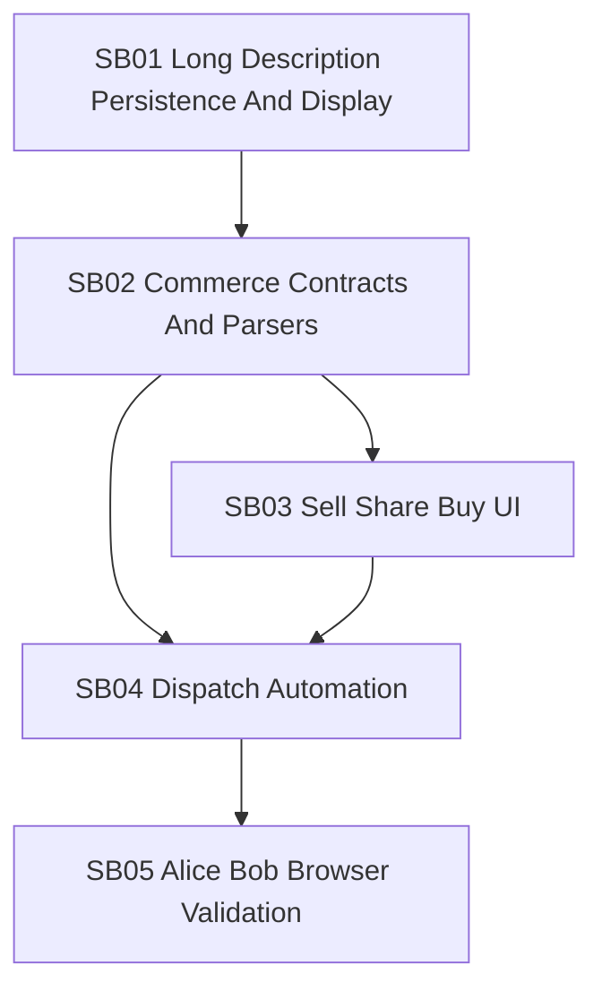

# Phase Plan

## Execution Order

1. `SB01 Long Description Persistence And Display`
2. `SB02 Commerce Contracts And Parsers`
3. `SB03 Sell Share Buy UI`
4. `SB04 Dispatch Automation`
5. `SB05 Alice Bob Browser Validation`

## Subbundle Dependency Map

## Critical Subbundles

| Subbundle | Critical foundation? | Why |
| --- | --- | --- |
| `SB01` | Yes | Long payload text and raw-state visibility are required before commerce records can be trusted in UI and raw ledger state. |
| `SB02` | Yes | Commerce contracts define the production states consumed by buy UI, dispatcher, dashboard, and tests. |
| `SB04` | Yes | Dispatch idempotency and clone-limit behavior determine whether real funds/BO ownership can be safely exercised. |
| `SB05` | Yes | Final browser proof closes the user-visible Alice/Bob workflow and catches integration gaps. |

## Phase Gates

| Phase | Entry criteria | Exit criteria | Reopen trigger |
| --- | --- | --- | --- |
| `SB01` | Bundle prepared; current wizard/details source understood. | Long text round-trips through builder/parser/UI/raw state with failing-first and passing proof. | Any later commerce payload field is hidden or absent from raw state. |
| `SB02` | `SB01` closure gate passed. | Sale/payment/purchase/receipt contracts and parsers covered by tests and source assertions. | UI or dispatch needs unplanned status/fields. |
| `SB03` | `SB02` contract tests pass. | Set Sale, share link, Buy BO route, local unlock/payment submit, dashboard panels work in browser. | Buy page cannot load by API or dialogs fail open-state proof. |
| `SB04` | `SB02` and `SB03` pass; browser payment can be produced. | Seller refresh dispatches original/copy idempotently, enforces max clones, and creates linked receipt/purchase/payment state. | Duplicate dispatch, missing receipt, or wrong owner after refresh. |
| `SB05` | `SB04` tests pass and apps/node are running. | Alice/Bob real browser validation plus screenshots and raw note closure complete. | Any raw note remains partial or unproven. |
