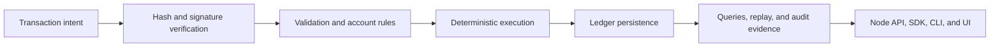

# Ledger Runtime Architecture

CanDoItAll.Ledger is organized around a deterministic transaction engine with
replaceable storage, hosting, client, and presentation layers.

## Trust Model

The Ledger does not treat a submitted command as truth. A financial state
change passes through explicit contracts:

1. A caller constructs transaction intent against known ledger state.
2. Cryptographic drivers verify hashes, keys, and signatures.
3. Validation checks structure, references, authority, rules, and conservation
   requirements.
4. The execution engine applies deterministic state transitions.
5. Persistence records the accepted transaction and resulting state.
6. Replay and chain verification can reconstruct and check ledger continuity.
7. APIs, SDKs, projections, and components expose the confirmed result.

Cryptography and a transaction chain improve tamper evidence and
accountability. They do not remove the need to secure private keys, hosts,
databases, authorization policy, backups, and application integrations.

## Runtime Layers

| Layer | Responsibility |
| --- | --- |
| `CanDoItAll.Ledger.Core` | Transaction, account, chain, amount, storage, and validation contracts |
| `CanDoItAll.Ledger.Cryptography*` | Hashing, key material, signatures, and browser-compatible cryptography |
| `CanDoItAll.Ledger.Engine` | Validation, execution, replay, state transition, and chain verification |
| `CanDoItAll.Ledger.Storage.InMemory` | Fast, isolated storage for tests and local workflows |
| `CanDoItAll.Ledger.Persistence.EFCore` | Relational persistence implementation and projections |
| `CanDoItAll.Ledger.Persistence.PostgreSql` | PostgreSQL registration, migrations, and schema checks |
| `CanDoItAll.Ledger.BusinessObjects` | Higher-level object ownership, lifecycle, commerce, and transaction builders |
| `CanDoItAll.Ledger.Rules.NCalc` | Expression-based account-rule evaluation |
| `CanDoItAll.Ledger.Node` | HTTP APIs, authentication, administration, health, and operator UI |
| `CanDoItAll.Ledger.Sdk` | Client-facing node and ledger access |
| `CanDoItAll.Ledger.Components` | Reusable ledger and business-object UI |

CLI, demos, AccountApps, AppHost, and seeding tools compose those layers for
learning, development, integration, and operational checks.

## Dependency Direction

Core contracts sit at the center. Cryptography, execution, rules, and storage
implement those contracts. Business-object and client layers build on the
confirmed Ledger model. Hosts and user interfaces remain at the composition
edge.

Infrastructure providers must not define transaction truth. User interfaces
must not bypass engine validation. Simulator projections must not be written
back as confirmed facts without an explicit, authorized Ledger transaction.

## Evidence Classes

The product deliberately distinguishes:

- **intent**: a proposed action that has not been accepted;
- **confirmed fact**: an accepted transaction and its resulting Ledger state;
- **derived view**: a query, balance, projection, or UI model reconstructed from
  confirmed facts;
- **simulation**: a hypothetical result produced from assumptions and scenario
  inputs.

Only confirmed facts belong to the authoritative transaction history. Derived
views can be rebuilt. Simulations remain labeled and independently versioned.
