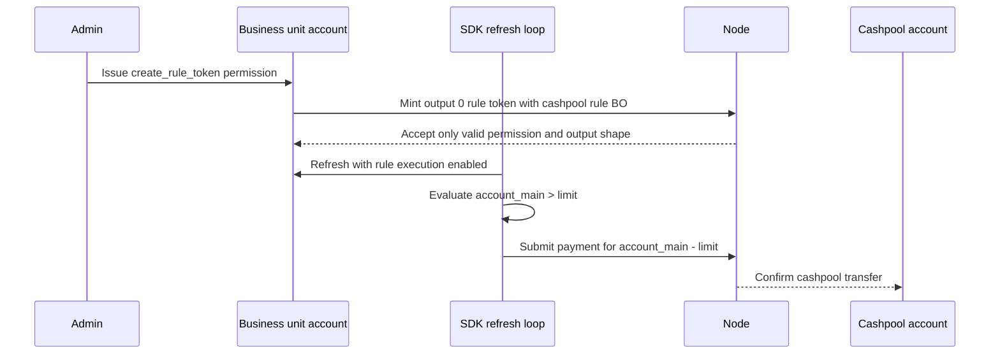
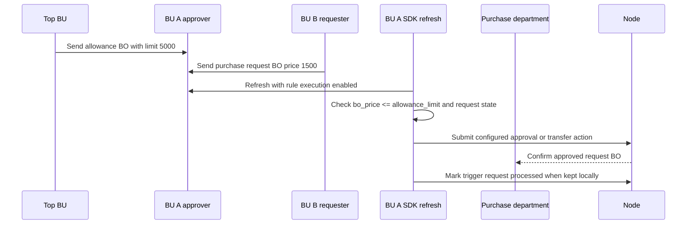
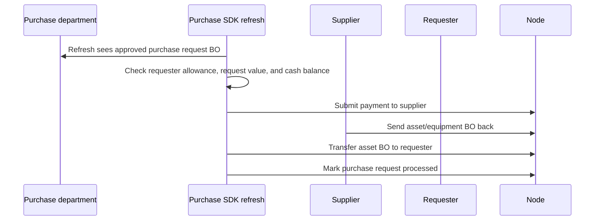

# Economy Simulator
> Historical design record. Project names and some integration claims below describe the pre-move Economy repository. For the current Ledger-owned simulator, its confirmed limitations, and the active refactoring boundary, see [`../architecture/ledger-simulator-vision-and-refactoring.md`](../architecture/ledger-simulator-vision-and-refactoring.md).

The economy simulator is an SDK-level example that sits above `CanDoItAll.Economy.Sdk`. It demonstrates how to model business units, economic events, templates, scenario runs, projections, actual tracking, reconciliation, calibration, and external settlement policy without moving simulator-specific concepts into Core, Ledger, BusinessObjects, SDK, Node, or CLI.

## Projects

| Project | Purpose |
| --- | --- |
| `src/CanDoItAll.Economy.Simulator` | Headless domain/application library. References SDK, BusinessObjects, and Core. |
| `src/CanDoItAll.Economy.Simulator.Persistence.EFCore` | Optional simulator projection/cache persistence through `IDbContextFactory`. |
| `src/CanDoItAll.Economy.Simulator.Components` | BaseLib/SDK-based simulator UI components. |
| `examples/CanDoItAll.Ledger.Simulator.App` | Blazor SSR example app. |

## Persistence Modes

The SSR app supports both modes through configuration:

```json
{
  "EconomySimulator": {
    "StorageMode": "InMemory"
  }
}
```

Use `StorageMode = "PostgreSql"` and set `EconomySimulator:PostgreSql:ConnectionString` to use PostgreSQL. In-memory and PostgreSQL paths register both the existing ledger persistence and simulator projection persistence via `AddDbContextFactory`.

Current host note: this setting configures the projection provider adapters, but the run lifecycle does not write through them yet. The project workspace, runs, and generated graphs remain in memory.

## P0 Settlement Policy

The SDK has `TransactionKind.Burn`, but no high-level SDK/BusinessObject burn helper was added for this implementation. The simulator therefore uses the P0 policy `external-clearing-transfer`: external inflows and outflows are represented by auditable `ExternalSettlementState` objects and transfers to or from an external-clearing BU/address.

## Semi Smart Account Rules

The simulator can use account rules to automate repeatable company behavior while keeping simulator-specific concepts above the ledger. Rules live as BO data on accounts, are authorized by rule-creation permission tokens, and execute only when a simulator app or worker enables `AccountRuleExecutionOptions` during refresh.

`EconomySimulatorCommonRuleFactory` provides reusable CFO-control rule families for cashpool sweep, reserve floor guard, purchase approval, payable payment, receivable follow-up, external settlement, CapEx approval, rule-state cadence, and rule-execution evidence mapping. These factories produce normal `AccountRuleDefinition` values; the simulator does not add node-side rule execution or simulator concepts to Core/Ledger.

`EconomySimulatorScenarioRulePackCatalog` materializes scenario-specific packs:

| Scenario | Implemented rule processes |
| --- | --- |
| `S1` online services | enterprise AR follow-up, implementation/license milestone collection, hiring equipment routing, cloud spend guard, department spend approval, cash reserve guard, cashpool sweep |
| `S2` bakery | ingredient reorder routing, supplier payment window, daily retail cash sweep, wholesale AR follow-up, production exception routing, wage/rent liquidity guard |
| `S3` hardware engineering | customer AR follow-up, component reorder request, WIP stage transfer, quality hold/release, tooling CapEx gate, maintenance payment, external settlement, revolver draw request |

Rules route and mark BOs, pay approved payables/settlements, and update rule-state/evidence fields. Scheduled revenue, payroll, depreciation, demand, baseline inventory consumption, COGS, and KPI calculations remain in the deterministic compiler/projection layer.

## Simulation Project Management

The simulator UI starts in an app shell with persistent navigation for Projects and Runs. `/` opens the project management workbench. The left rail lists simulator projects with status, planning dates, last run, issue count, storage mode, and search. The right workspace shows the selected project and uses tabs for:

- Basic info: project identity, schema, base currency, planning window, calendar, defaults, metadata, and validation feedback.
- BUs and accounts: a tree-detail designer for business units and account bindings, including roles, validity windows, parent links, address status, and validation.
- BOs and rules: project folders for project config, BU objects, financial inputs, rule packs, trigger templates, and evidence templates. Rule definitions reuse `AccountRuleDefinition` and the existing account-rule preview.
- Financial inputs: typed assumptions for tax, inflation, customer acquisition, collection delay, supplier terms, wages, and custom drivers.
- Simulation setup: scenario id/name, step period, step count, horizon, UI speed, seed, included BUs, included templates, rule execution mode, assumption overrides, deterministic setup hash, and run launch.
- Export/import: deterministic manifests containing the complete project state plus content hashes and validation preview before import.

Clicking `Run selected`, the project-level `Run` action, or a setup-level `Run` action validates the current project and opens a run-mode dialog. Automatic mode creates a run through `ISimulationRunLifecycleService`, materializes all configured steps to the setup horizon, and navigates to `/runs/{runId}`. Manual stepping creates the run at step 1, navigates to `/runs/{runId}`, and waits for explicit timeline next/select requests. Validation blockers stay on the Projects page through the same `SimulationProjectValidationMessage` model used by import/export validation.

These concepts live in `CanDoItAll.Economy.Simulator` and `CanDoItAll.Economy.Simulator.Components`. The project manifest includes BUs/accounts, folders, BO/rule definitions, financial input profiles, run setups, and validation metadata without moving simulator-only policy into Core, Ledger, Node, or generic BusinessObjects.

## Run Observation

The example app exposes `/runs`, `/runs/{runId}`, and the compatibility route `/run-observation` for inspecting simulation runs. The Runs surface has a run-history rail with statuses, elapsed time, warning/error counts, search, and start-new-run action. The selected run page joins lifecycle state, clock, graph data, BU/account snapshots, current BO definitions, rule execution evidence, issues, resource diagnostics, artifacts, and output hashes for the same project/scenario/run identifiers. It also shows a reusable BaseLib timeline stepper that displays the selected step, total steps, materialized range, current date, and previous/next controls.

`InMemorySimulationRunLifecycleService` is the current deterministic provider. It models queued/running/paused/stopped/completed/warning/failed records, automatic versus manual run modes, selected and available timeline steps, snapshot materialization, command validation, restart IDs, output hashes, pipeline steps, resource snapshots, run events, assumptions, and partial failed-run artifacts. Backward stepping loads an existing snapshot without re-simulating; forward stepping creates missing snapshots until the requested step. The service is intentionally replaceable by durable storage or a real runner without changing the Blazor components.

Run observation tabs include:

- State: selected-run header metadata, lifecycle controls, macro KPI band, run clock, recent events, top issues, resource usage, simulation pipeline, and footer status.
- Graphs: reusable graph analytics for cash flow, revenue, and expense, plus a data fallback summary so screenshots and browser proof remain inspectable even if the JS chart hydrates late.
- BUs: tree-detail account observation with balances, role/status, related BO ids, processed/failed/skipped rule evidence, and related issues.
- BO Evidence: rule execution evidence, current BO definitions, and output-source mapping for visible macro KPI and option outputs.
- Issues: simulation issues tied to dates, BUs, failed transactions, objects, and amounts.
- Artifacts: generated run artifacts and output hash catalog.

Failed runs must remain inspectable: the run rail shows error counts, the State tab shows failure status, events, issues, and a failed pipeline step, the Issues tab shows the complete issue rows, and the Artifacts tab keeps partial output hashes and logs.

The macro KPI source map currently covers fiscal policy, monetary policy, labor market, external sector, inventory/supply, and treasury/cash domains through BO/BU labels and rule evidence. This keeps the dashboard honest: UI values are tied to simulator-owned source records rather than anonymous display cards.

UI speed is deliberately excluded from deterministic run setup hashes; it changes observation playback only, not scenario output identity.

## Simulator API

The simulator app maps grouped Minimal API endpoints under `/api/simulator` through `MapEconomySimulatorApi()`. The API is intentionally grouped by use case instead of exposed as a flat utility bag:

| Group | Routes | Purpose |
| --- | --- | --- |
| Metadata | `/metadata/function-map`, `/metadata/endpoints`, `/metadata/cfo-coverage` | Returns the function/API map and CFO coverage checklist used by workbook and client integration. |
| Projects | `/projects`, `/projects/{projectId}`, `/projects/validate`, `/projects/import`, `/projects/{projectId}/export`, `/projects/{projectId}/runs` | Controls simulation project state, import/export, validation, setup hashing, and run launch. |
| Scenario templates | `/scenario-templates`, `/scenario-templates/{scenarioCode}`, `/scenario-templates/{scenarioCode}/rule-pack` | Exposes S1/S2/S3 business model templates and scenario rule packs. |
| Scenarios | `/scenarios/compile`, `/scenarios/run` | Compiles scenario events and runs explicit scenario requests through implemented simulator services. |
| Runs | `/runs`, `/runs/{runId}`, `/runs/{runId}/commands`, `/runs/{runId}/steps`, `/runs/{runId}/observation`, `/runs/{runId}/graphs`, `/runs/{runId}/analysis/finance`, `/runs/{runId}/analysis/source-map` | Controls run lifecycle, timeline stepping, and post-run observation, graph, source-map, and CFO finance analysis data. |
| Analysis | `/analysis/projection`, `/analysis/actuals/validate`, `/analysis/calibration/recommend` | Runs standalone cash-flow projection, actual-entry validation, and assumption calibration helpers. |

The API uses real simulator services: project validation/import/export, scenario template catalog, event compiler, scenario runner, projection service, run lifecycle service, run observation, and calibration/actuals services. The default `ISimulationProjectWorkspaceService` is in-memory and replaceable; hosts that need durable multi-user project storage should register their own workspace service. CFO analysis is management-oriented and flags generic tax, payroll, legal, statutory, debt covenant, and transfer-pricing gaps as professional-review items.

The current function/API workbook is generated at `outputs/simulator-api-map-20260514/EconomySimulatorFunctionApiMap.xlsx`.

Cashpool sweep:



Purchase allowance approval:



Purchasing and asset fulfillment:



## Validation

```powershell
dotnet test tests\CanDoItAll.Ledger.Tests\CanDoItAll.Ledger.Tests.csproj --no-restore --disable-build-servers --filter FullyQualifiedName~EconomySimulator
dotnet build examples\CanDoItAll.Ledger.Simulator.App\CanDoItAll.Ledger.Simulator.App.csproj --no-restore --disable-build-servers
dotnet run --disable-build-servers --project examples\CanDoItAll.Ledger.Simulator.App\CanDoItAll.Ledger.Simulator.App.csproj -- --urls http://127.0.0.1:5287
```

Browser validation screenshots are recorded under `output/playwright/economy-simulator-run-console/` during run-console validation.
