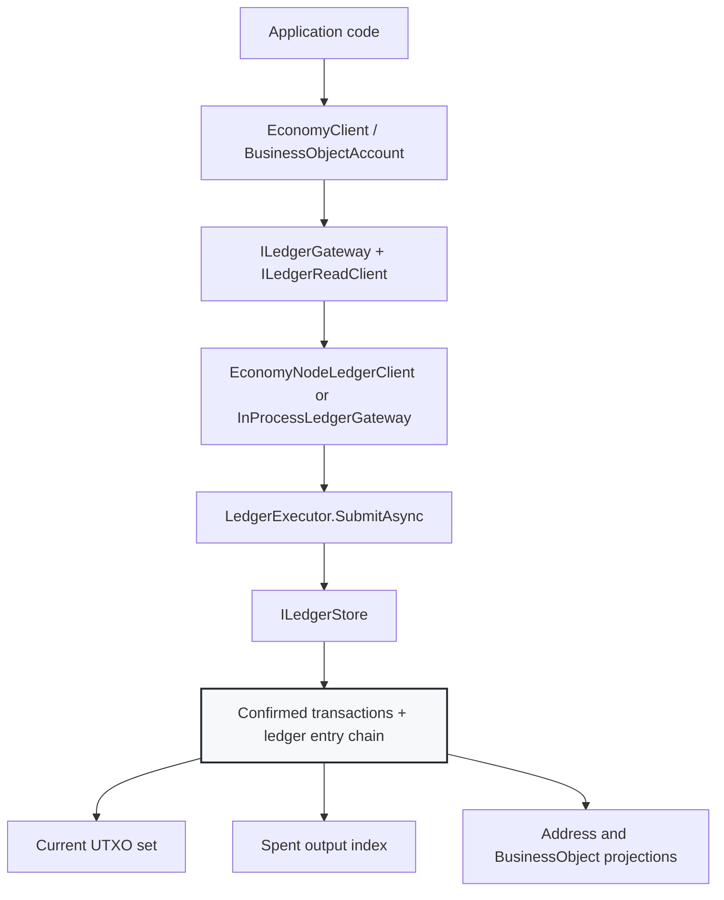
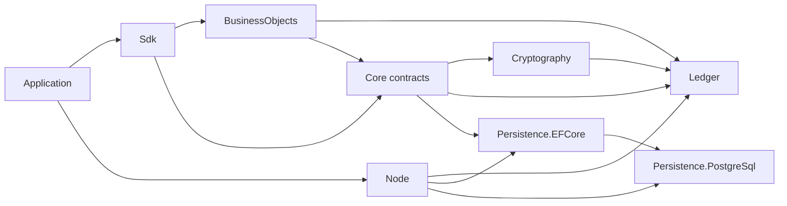
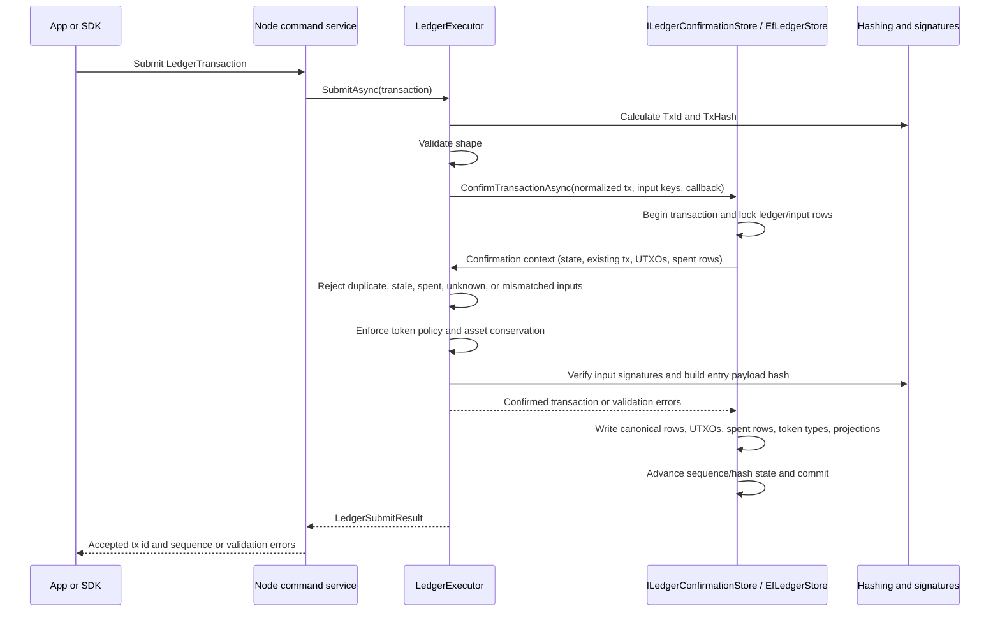
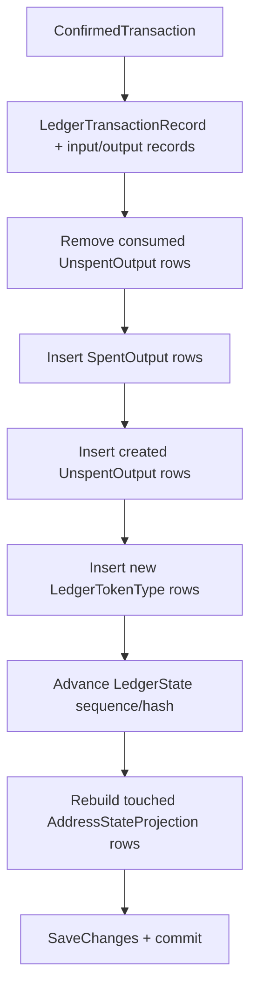
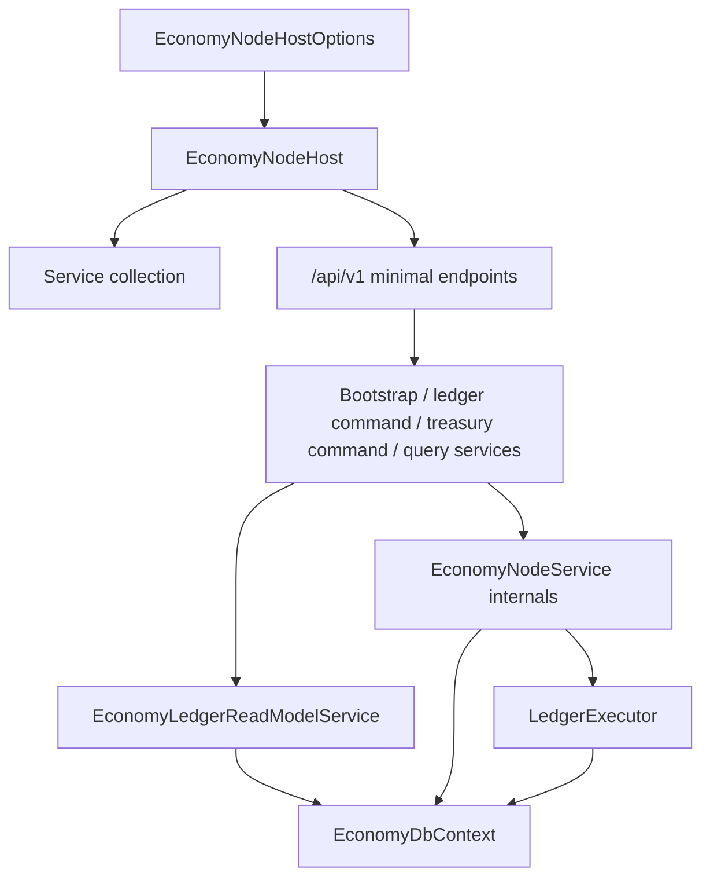
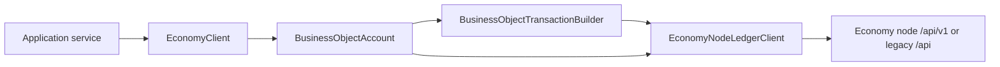

# Ledger and Node Guide

This guide explains how the Economy ledger and node work from code. It focuses on the headless ledger, node host, persistence, and SDK/driver integration paths. UI developer instructions are intentionally out of scope.

## Mental Model

CanDoItAll.Economy is a single-node, UTXO-like accounting ledger. It is not a distributed blockchain. Confirmed transactions and the ledger entry hash chain are canonical; UTXOs, spent-output rows, account balances, and BusinessObject holdings are projections that can be rebuilt from confirmed ledger history.

## Project Roles

| Project | Role |
| --- | --- |
| `CanDoItAll.Economy.Core` | Domain records and contracts: transactions, inputs, outputs, UTXOs, ledger state, validation results, and interfaces. |
| `CanDoItAll.Economy.Cryptography` | Canonical transaction serialization, transaction hashes, signature payloads, and signature providers. |
| `CanDoItAll.Economy.Ledger` | Transaction validation, signature checks, conservation checks, token creation policy, and confirmation orchestration. |
| `CanDoItAll.Economy.Persistence.EFCore` | Durable EF Core store for ledger state, transaction rows, UTXO/spent rows, and projections. |
| `CanDoItAll.Economy.Persistence.PostgreSql` | PostgreSQL persistence configuration on top of the EF Core store. |
| `CanDoItAll.Economy.Node` | Headless node host, HTTP API, treasury/bootstrap helpers, and node service reads/writes. |
| `CanDoItAll.Economy.Sdk` | Code-facing facade and node HTTP driver for applications. |
| `CanDoItAll.Economy.BusinessObjects` | Account/key abstractions and transaction builders over the ledger. |

## Canonical Data

The canonical write path is:

1. A `LedgerTransaction` is submitted.
2. The ledger calculates `TxId` from canonical transaction core content and `TxHash` from the submitted envelope.
3. The ledger validates transaction shape, input references, signatures, token policy, and asset conservation.
4. A `ConfirmedTransaction` is built with `LedgerSequence`, `PreviousLedgerHash`, `LedgerEntryHash`, `AdminSignature`, and `ConfirmedAt`.
5. The store appends the confirmed transaction and updates derived rows atomically.

The most important rule: business operations should submit transactions through `LedgerExecutor` or a service that calls it. Do not update projection tables as the business operation.

`TxId` intentionally excludes input signatures, existing client-supplied `TxId`, `TxHash`, status, ledger sequence, admin signature, and confirmation timestamp. That makes input signing non-circular. `TxHash` is the submitted-transaction hash and changes when signatures change.

Gate B now includes `LedgerChainVerifier`, persisted EF projection verification, signed snapshot creation/verification, and CLI operator commands. The verifier recomputes transaction ids, submitted hashes, ledger-entry hashes, sequence continuity, previous-hash continuity, input payload hashes, and admin-signature payload hashes from confirmed transactions; when trusted admin key material is configured it also verifies admin signatures cryptographically.

## Confirmation Sequence

`LedgerExecutor.SubmitAsync` owns normalization and validation order. Stores that implement `ILedgerConfirmationStore` let the executor evaluate the final confirmation decision inside a store-owned transaction. `EfLedgerStore` implements that Gate A path, so validation reads, PostgreSQL locks, append, sequence/hash advancement, token-type registration, and projection updates share one confirmation transaction.

Simple stores can still use the legacy `ILedgerStore` read-then-append path, which is suitable for in-memory tests but not the production persistence model.

## Validation Rules

The current code performs these checks before a transaction can be confirmed:

| Area | Current behavior | Main source |
| --- | --- | --- |
| Transaction shape | Requires positive version, outputs except burns, inputs except genesis, valid addresses, non-negative amounts, unique input/output indexes, and no duplicate outpoints. | `TransactionShapeValidator` |
| Genesis order | The first transaction for a ledger/scenario must be `Genesis`; later genesis transactions are rejected. | `LedgerExecutor.ValidateGenesisSequence` |
| Duplicate transaction | Existing `TxId` in the same ledger/scenario is rejected. | `LedgerExecutor.SubmitAsync` |
| Input references | Inputs must reference current unspent outputs, not spent or unknown outputs, and address must match previous output owner. | `LedgerExecutor.ValidateInputReferences` |
| Signatures | Signature payload hash must match independent/ordered signing mode; public key material must match the address and verify through the registry. | `LedgerExecutor.ValidateInputSignatures` |
| Asset conservation | Non-genesis, non-mint, non-burn transfers must balance main amount and token amounts. | `AssetConservationValidator` |
| Token creation authority | Minted token types and permission outputs are checked against treasury/permission policy when policy is enabled. | `TokenCreationPolicy` |
| Address policy | Gate A enforces derived address validity and signature ownership. Registered-address rows are metadata/reserved for future admission policy, not a required output-address allowlist. | `TransactionShapeValidator`, `LedgerExecutor.ValidateInputSignatures` |

## Persistence and Projections

EF persistence stores canonical transaction rows and derived indexes together. The Gate A confirmation path opens a database transaction, locks ledger state for update, locks input UTXOs for PostgreSQL, evaluates the executor callback against those locked reads, and commits the accepted transaction in the same context.

Projection rows are convenience read models. The store recalculates touched address balances from current UTXOs, serializes token balances, calculates a state hash, and stores the admin signature with the projection. `LedgerTokenType` rows protect new token ids from duplicate mint races. `BusinessObjectRecord` and `BusinessObjectVersionRecord` are also derived projections: append-time code updates them from BO-bearing UTXO outputs, and `EfLedgerProjectionRebuilder` can recreate them from confirmed transaction/input/output history. If projection rows are deleted or suspected, rebuild them from canonical history rather than editing them as primary truth.

BusinessObject canon for this stage is:

- confirmed transaction rows and BO-bearing UTXO transitions are canonical;
- `Economy_BusinessObjects` is the current-state projection by ledger/scenario/object id;
- `Economy_BusinessObjectVersions` is the version-history projection;
- node/account current holdings still read from current BO-bearing UTXOs, so projection tables must match UTXO-derived state rather than replace it.

## Node Runtime

`EconomyNodeHost` is the default host for a headless node. It configures:

- persistence provider: in-memory or PostgreSQL;
- transaction canonicalizer and hasher;
- signature payload builder;
- signature provider registry;
- account input signer;
- manual time provider;
- development or configured ledger admin signer;
- `/api/v1` endpoints plus optional legacy `/api` compatibility endpoints;
- opt-in API-key authorization for state-changing endpoints;
- token creation policy;
- `LedgerExecutor`;
- endpoint-facing application services:
  - `EconomyNodeBootstrapService`;
  - `EconomyLedgerCommandService`;
  - `EconomyTreasuryCommandService`;
  - `EconomyLedgerQueryService`;
- `EconomyLedgerReadModelService`, which owns EF-backed read-model queries and delegates record/DTO conversion to `EconomyNodeRecordMapper`;
- legacy `EconomyNodeService`, which now keeps treasury/bootstrap/command orchestration and delegates compatibility read methods to the read-model service.

`GET /api/v1/node/bootstrap` returns public bootstrap metadata, including public key material, default admin address, API version/base path, write authorization mode, and ledger-admin signer mode. It does not return private key material. `/api` routes are still mapped by default for older client compatibility; disable them with `EconomyNodeHostOptions.MapLegacyApiRoutes = false` after all consumers use the versioned path.

State-changing routes are open in `EconomyNodeApiSecurityMode.Development`. Set `ApiSecurityMode = RequireApiKey` and `ApiKey` to require the configured header (`X-CDA-Economy-Key` by default) on writes such as reset, mint, transfer, grants, and ledger transaction submission. Reads remain unauthenticated at this foundation stage; production deployments still need perimeter auth, TLS, role policy, auditing, and key rotation.

Implemented API groups include:

| Route | Purpose |
| --- | --- |
| `GET /api/v1/health` | Basic health probe. |
| `GET /api/v1/node/bootstrap` | Returns default ledger/bootstrap/admin metadata and public API/security posture. |
| `GET /api/v1/time`, `POST /api/v1/time/advance` | Inspect or advance the node's manual clock. |
| `POST /api/v1/ledger/reset` | Recreate the ledger state for development. |
| `POST /api/v1/transactions/mint` | Treasury helper mint path. |
| `POST /api/v1/transactions/transfer` | Treasury helper transfer path. |
| `POST /api/v1/token-authorities/grants` | Grant token creation authority. |
| `POST /api/v1/permissions/grants` | Grant a permission token. |
| `POST /api/v1/ledger/transactions` | Submit a fully formed signed ledger transaction. |
| `GET /api/v1/ledger/{ledgerId}/accounts/{address}/spendable-outputs` | Read spendable UTXOs for an address. |
| `GET /api/v1/ledger/{ledgerId}/accounts/{address}/business-objects` | Read current BusinessObject holdings. |
| `GET /api/v1/ledger/{ledgerId}/accounts/{address}/transactions` | Read transaction history for an address. |
| `GET /api/v1/accounts` | Read account summaries for the default ledger. |
| `GET /api/v1/accounts/{address}/transactions` | Read transactions touching an address. |
| `GET /api/v1/transactions/{txId}` | Read transaction details. |

The same routes are also exposed under `/api/...` while `MapLegacyApiRoutes` remains enabled.

## SDK and Driver Relationship

Applications can integrate at two levels:

- `EconomyNodeLedgerClient` is a node HTTP driver. It implements `ILedgerGateway` and `ILedgerReadClient`.
- `EconomyClient` is a higher-level facade. It loads `BusinessObjectAccount` instances, submits transactions, reads balances/history, exports keys, and exposes account message security helpers.

The SDK now has DI helpers for code-first consumers:

- `AddEconomySdkWithNodeDriver(nodeBaseUri)` registers the node HTTP driver as both `ILedgerGateway` and `ILedgerReadClient`, plus default crypto/signing/time services and `EconomyClient`.
- The node driver uses `/api/v1` by default, accepts `EconomyNodeLedgerClientOptions` for legacy `/api` compatibility, and can send the configured write API key header.
- `AddEconomySdkWithGateway<TGateway>()` registers a custom gateway that implements both contracts.

When the node returns a non-success HTTP status for driver reads, the SDK raises `EconomyNodeRequestException` with the HTTP status and parsed problem `title`/`detail` when present. Ledger validation failures from transaction submission still flow through `LedgerSubmitResult`.

For local simulations and tests, `InProcessLedgerGateway` implements the same `ILedgerGateway`/`ILedgerReadClient` contracts without HTTP. That makes the driver choice a composition concern rather than a different application model.

## Scenarios

`LedgerAccountContext` contains `LedgerId` and optional `ScenarioId`. The same address can hold different balances in different scenarios because UTXO queries and transactions include both ledger id and scenario id.

Use scenarios for simulations, forks, or "what if" flows. Use the default scenario for live operational state.

## Admin Signatures

The node admin signer signs the ledger entry payload hash after validation. This is tamper evidence for the single-node ledger, not distributed consensus. The append path also stores admin signatures with spent output and projection records so direct database edits are easier to detect.

By default the node uses `DevelopmentLedgerAdminSigner`, which is explicit development scaffolding. For production-like deployments, configure `EconomyNodeHostOptions.LedgerAdminAccount` or the `Economy:LedgerAdmin:*` configuration keys (`KeyId`, `Algorithm`, `PublicKey`, `PrivateKey`). The private key is used only inside the signer and is not returned by bootstrap. Environment fallbacks are available through `CANDOITALL_ECONOMY_LEDGER_ADMIN_KEY_ID`, `CANDOITALL_ECONOMY_LEDGER_ADMIN_ALGORITHM`, `CANDOITALL_ECONOMY_LEDGER_ADMIN_PUBLIC_KEY`, and `CANDOITALL_ECONOMY_LEDGER_ADMIN_PRIVATE_KEY`.

## Do Not Bypass

- Do not write directly to `UnspentOutputs`, `SpentOutputs`, `AddressStateProjections`, `BusinessObjects`, or `BusinessObjectVersions` as a business operation.
- Do not treat account balance projections as canonical ledger state.
- Do not mint token types without satisfying token creation policy.
- Do not use the node treasury helper as a general account signer for non-treasury accounts; account transfers should submit signed ledger transactions.

## Source Reference Map

| Concept | Source file |
| --- | --- |
| Ledger contracts | `src/CanDoItAll.Economy.Core/Abstractions.cs` |
| Transaction records | `src/CanDoItAll.Economy.Core/Transactions.cs` |
| UTXO, spent output, projection records | `src/CanDoItAll.Economy.Core/StorageModels.cs` |
| Confirmation orchestration | `src/CanDoItAll.Economy.Ledger/LedgerExecutor.cs` |
| Chain verification foundation | `src/CanDoItAll.Economy.Ledger/LedgerChainVerifier.cs` |
| Shape validation | `src/CanDoItAll.Economy.Ledger/TransactionShapeValidator.cs` |
| Conservation validation | `src/CanDoItAll.Economy.Ledger/AssetConservationValidator.cs` |
| Token/permission policy | `src/CanDoItAll.Economy.Ledger/TokenCreationPolicy.cs` |
| EF append path and projections | `src/CanDoItAll.Economy.Persistence.EFCore/EfLedgerStore.cs` |
| EF projection rebuild | `src/CanDoItAll.Economy.Persistence.EFCore/EfLedgerProjectionRebuilder.cs` |
| EF BusinessObject projection mapping | `src/CanDoItAll.Economy.Persistence.EFCore/EfBusinessObjectProjectionMapper.cs` |
| Node host and endpoints | `src/CanDoItAll.Economy.Node/EconomyNodeHost.cs` |
| Configured node admin signing | `src/CanDoItAll.Economy.Node/ConfiguredLedgerAdminSigner.cs` |
| Node endpoint-facing services | `src/CanDoItAll.Economy.Node/EconomyNodeApplicationServices.cs` |
| Node read-model queries and DTO mapping | `src/CanDoItAll.Economy.Node/EconomyLedgerReadModelService.cs` |
| Node operations | `src/CanDoItAll.Economy.Node/EconomyNodeService.cs` |
| Node HTTP driver | `src/CanDoItAll.Economy.Sdk/EconomyNodeLedgerClient.cs` |
| High-level SDK facade | `src/CanDoItAll.Economy.Sdk/EconomyClient.cs` |

## Related Docs

- [Architecture](ARCHITECTURE.md)
- [Ledger validation](LEDGER_VALIDATION.md)
- [Transaction format](TRANSACTION_FORMAT.md)
- [Node and CLI](NODE_AND_CLI.md)
- [Ledger/node infographics](LEDGER_NODE_INFOGRAPHICS.md)
- [Developer wiki](developer/README.md)
