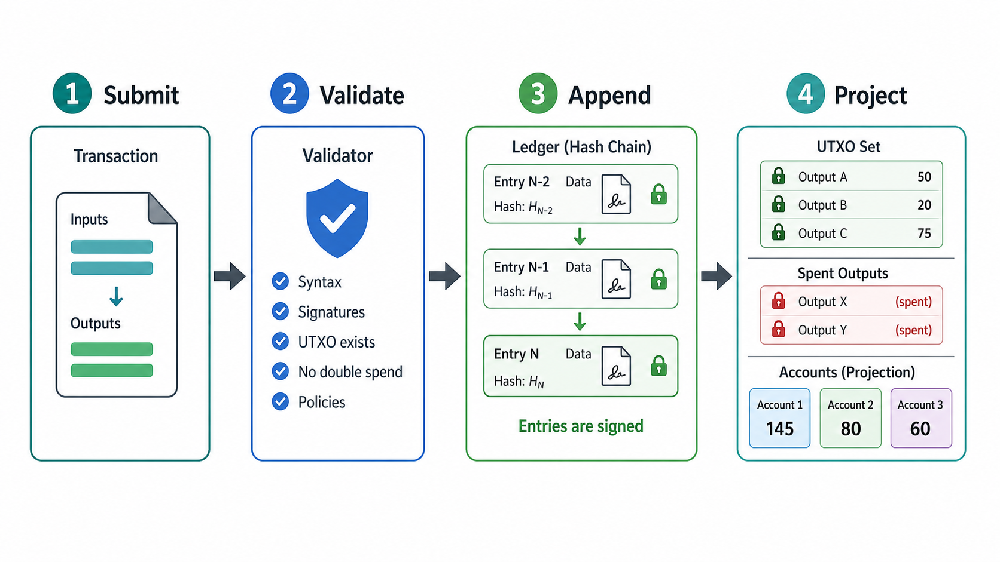
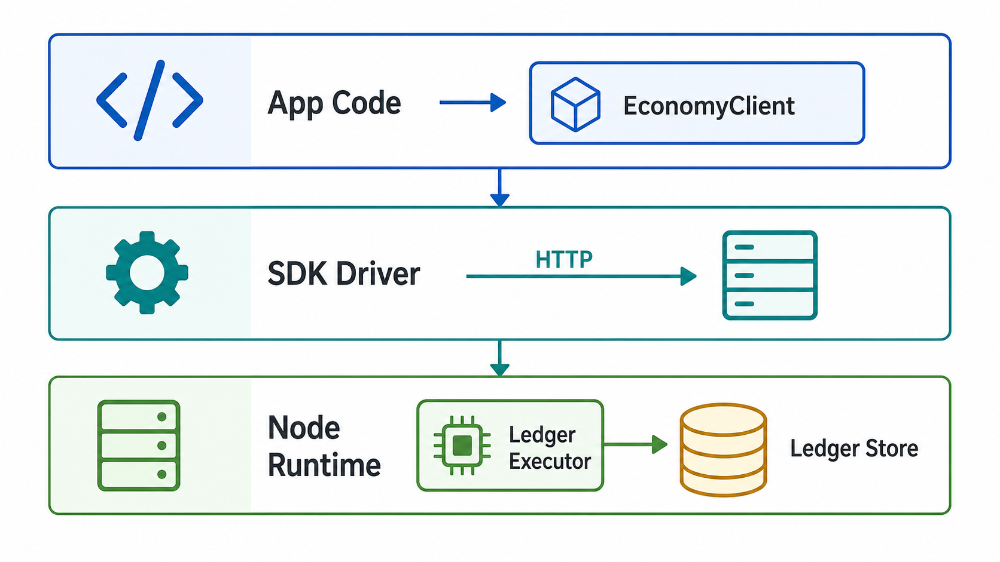
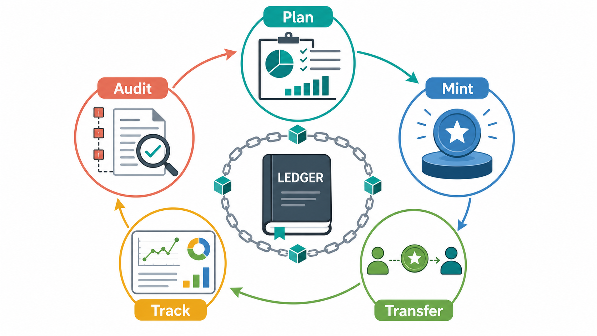

# Ledger and Node Infographics

These smaller generated assets explain the ledger/node model from different angles. The exact technical details remain in [Ledger and Node Guide](LEDGER_NODE_GUIDE.md); these images are quick visual aids for docs, reviews, and onboarding.

## Confirmation Flow

Use this for technical readers who need the core write path:

1. Submit a transaction.
2. Validate shape, inputs, signatures, double-spend rules, and policies.
3. Append a signed ledger entry into the hash chain.
4. Project current UTXOs, spent outputs, and account balances for reads.

## SDK to Node Runtime

Use this for programmers deciding how their application talks to Economy:

1. Application code works with `EconomyClient` and account objects.
2. The SDK driver implements `ILedgerGateway` and `ILedgerReadClient`.
3. The node runtime receives HTTP requests, calls `LedgerExecutor`, and persists through the ledger store.

For local tests or simulations, the same gateway/read interfaces can be backed by `InProcessLedgerGateway` instead of an HTTP node.

## Business Value Loop

Use this for business and product discussions:

1. Plan budgets, project states, and scenario flows.
2. Mint or allocate value and permission tokens through policy.
3. Transfer value or BusinessObjects between accounts.
4. Track balances, holdings, and projections.
5. Audit the signed ledger history and hash chain.

The loop is single-node accounting infrastructure, not distributed consensus. It gives product teams a practical ledger with traceable ownership, policy checks, and rebuildable projections.

## Image Generation Notes

- Mode: built-in `image_gen`.
- Generated source folder: `C:\Users\dell\.codex\generated_images\019e0e7d-241a-7b20-ac95-c82c0ac26499`.
- Project copies:
  - `docs/assets/infographics/ledger-confirmation-flow.png`
  - `docs/assets/infographics/node-sdk-runtime.png`
  - `docs/assets/infographics/business-value-loop.png`
