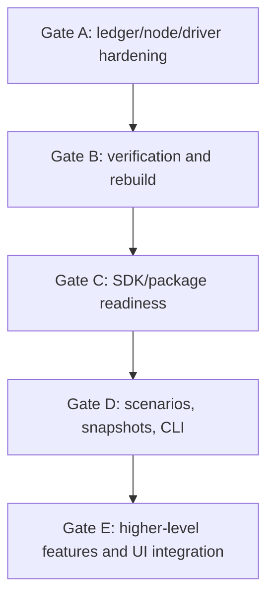

# Roadmap

Last reviewed: 2026-05-10.

This roadmap is intentionally architecture-first. The Economy module already has a useful ledger, node, SDK, BusinessObject layer, persistence model, and tests. Gate A hardened the ledger/node/driver foundation, and Gate B now adds independent chain verification, persisted projection hashes, signed snapshots, operator commands, health/readiness reporting, and ledger-level BusinessObject transition rejection. Production readiness still depends on auth, migrations, backup/restore drills, key rotation, monitoring, and release-grade SDK policy.

## Stage Legend

| Stage | Meaning |
| --- | --- |
| `Implemented` | Code exists and is covered enough for normal internal development. |
| `Hardened Alpha` | Code exists, Gate A stabilization proof is in place for the core path, and remaining work is production hardening rather than basic correctness. |
| `Alpha` | Code exists and works for core flows, but architecture, tests, or production readiness still need hardening. |
| `Partial` | Some code/docs exist, but key behavior is missing or not wired into the main path. |
| `Planned` | Mostly documented or stubbed; implementation still needs to happen. |

## Current Architecture Stage

| Area | Stage | What we have now | What is still missing or risky |
| --- | --- | --- | --- |
| Repository foundation | Implemented | Solution, project split, docs, examples, and xUnit test project are in place. | Build/test environment needs stable automation; current full build can be blocked by a running demo process locking outputs. |
| Core transaction model | Alpha | Immutable ledger records, transaction inputs/outputs, UTXO records, ledger state, scenario ids, validation results, and storage interfaces. | Public contract needs stabilization before external SDK use; some records exist ahead of behavior such as snapshots and archives. |
| Canonical hashing and signatures | Hardened Alpha | Transaction canonicalizer, content-derived `TxId`, submitted-envelope `TxHash`, outpoint hash, signature payload builder, default signature registry, ECDSA provider, VEF fallback, account message security, regression proof that signatures/stale ids do not alter `TxId` while core content does, v1 golden-vector tests for `TxId`, `TxHash`, outpoint key, input payload hash, and ledger entry hash, configured ledger-admin signer path, and strict trusted-admin-key verification in `LedgerChainVerifier`. | Needs explicit external compatibility policy, key lifecycle policy, rotation, and secret/HSM integration before production. |
| Ledger executor | Hardened Alpha | `LedgerExecutor` calculates ids, validates shape/genesis/duplicates/input references/BusinessObject transitions/signatures/token policy/asset conservation, signs ledger entries, and uses `ILedgerConfirmationStore` for transaction-scoped confirmation when the store supports it. `LedgerChainVerifier` now recomputes canonical ids/hashes, sequence continuity, previous-hash continuity, entry hashes, input payload hashes, and admin signatures for confirmed history. | Fallback stores still use the simpler read-then-append path; future production stores must implement the confirmation contract. |
| In-memory store | Implemented for tests | `InMemoryLedgerStore` supports deterministic executor tests, UTXO movement, spent index, token existence, and ledger state. | It is not a production store and has no shared projection engine with EF or the in-process driver. |
| EF Core persistence | Hardened Alpha | `EfLedgerStore` implements `ILedgerConfirmationStore`, opens a confirmation transaction, locks ledger state/input UTXOs where supported, appends canonical rows, moves UTXOs/spent rows, updates projections, and records token types in a dedicated registry. `EfLedgerProjectionRebuilder` rebuilds derived rows from confirmed history; `EfLedgerProjectionVerifier` calculates deterministic projection hashes and detects persisted corruption; `EfLedgerSnapshotService` creates and verifies signed snapshots. | Needs formal migrations strategy, broader stress testing, restore drills, and stronger operational migration/index validation. |
| PostgreSQL persistence | Hardened Alpha | PostgreSQL provider is wired through EF Core; Gate A tests prove concurrent double-spend and duplicate-token mint races confirm only one winner. A first PostgreSQL operations runbook now covers backups, migration preflight, rebuild, validation, and rollback posture. | Need repeatable containerized test infrastructure, committed EF migrations, migration validation, monitoring, and backup/restore drills with exact environment commands. |
| Node host/runtime | Hardened Alpha | `EconomyNodeHost` configures persistence, crypto, manual time, token policy, bootstrap, thin Minimal API endpoints, endpoint-facing application services, `/api/v1` routes with default legacy `/api` compatibility, opt-in API-key authorization for mutating endpoints, configured ledger-admin signing, and `/health` readiness output with storage, latest ledger hash/sequence, chain/projection verification status, API/security posture, bootstrap status, and signer mode. Bootstrap no longer returns private key material. | The API-key mode is a foundation, not a product auth model. Needs role/user policy, TLS/perimeter guidance, audit logging, key rotation, and legacy-route sunset policy. |
| Node service | Hardened Alpha | Endpoints now depend on smaller bootstrap, ledger-command, treasury-command, and ledger-query services. `EconomyLedgerReadModelService` owns EF-backed read queries and record/DTO mapping, while legacy `EconomyNodeService` keeps command/bootstrap compatibility methods. | Treasury command policy and command-side EF selection still need deeper extraction before large endpoint expansion. |
| HTTP SDK driver | Hardened Alpha | `EconomyNodeLedgerClient` implements `ILedgerGateway` and `ILedgerReadClient`, defaults to `/api/v1`, can opt into legacy `/api`, can send the node write API key, exposes typed transaction details, has typed HTTP problem exceptions, observes cancellation, and is covered by live node parity tests against the in-process driver for core and BusinessObject flows. | Needs a formal timeout/retry/idempotency policy, package compatibility policy, and broader error/resilience coverage before external SDK release. |
| SDK facade | Hardened Alpha | `EconomyClient` loads accounts, delegates reads/writes, exports keys/subaccounts, exposes message security helpers, and now has DI helpers for node-driver and custom gateway composition with default crypto/signing/time services. | Needs package options, samples, compatibility docs, and contract-level tests before external SDK release. |
| In-process driver | Alpha | `InProcessLedgerGateway` provides the same gateway/read contracts without HTTP, powers tests/local workflows, and now has core parity coverage against the HTTP node driver. | It maintains its own read projections instead of reading authoritative store projections; replace or back it with a shared projection/query path. |
| BusinessObject layer | Hardened Alpha | Account helpers, transaction builders, advanced BO operations, token-backed objects, permission issuance, data item support, render/cast helpers, tests, EF projection/rebuild canon, HTTP-vs-in-process parity for a BO create/update read flow, and ledger-level create/update/transfer/close transition rejection. | Domain-specific BO state machines remain application policy; shared projection/query consolidation is still needed. |
| Token/permission policy | Hardened Alpha | Treasury-origin permission token model, namespace-bound mint authority, repeatable permission return checks, delegation tests, and a race-proof token-type registry for new token mints. | Needs production policy docs and query/reporting support for authorities. |
| Address registry | Partial | Registered address records and read contract exist. Gate A policy is derived-address validation plus signature ownership; registered-address rows are metadata/reserved for future admission policy. | If an allowlist is needed later, implement it as an explicit configurable policy rather than an assumed validation rule. |
| CLI | Partial | Gate B operator commands are implemented for `verify chain`, `verify projections`, `projections rebuild`, `snapshot create`, and `snapshot verify` over PostgreSQL or in-memory providers. | Wallet-style transaction drafting/submission, address commands, scenario commands, and archive commands are still future work. |
| Scenarios and simulation | Partial | `ScenarioId` is carried through transactions, UTXOs, EF records, node reads, SDK reads, and tests. | Snapshot-based fork, scenario lifecycle records, deterministic simulation runner, deficit detection, and scenario management APIs are missing. |
| Snapshots and archives | Partial | Signed EF snapshot creation and verification exist for ledger state, UTXO, address, and BusinessObject hashes, guarded by projection verification. | Rebuild-from-snapshot, archive compaction, archive verification, and restore flows remain future operational work. |
| Documentation | Implemented for current state | Ledger/node guide, infographic index, and developer wiki now explain the current code-first model. | Must stay synchronized as architecture changes; roadmap should be reviewed after each stabilization milestone. |
| UI integration | Later | Components and demo exist, but UI docs are intentionally out of scope for this pass. | Do not let UI feature pressure bypass ledger/node/driver hardening. |

## Architecture Findings

1. The Gate A confirmation boundary is now clean for EF-backed stores. `LedgerExecutor` delegates to `ILedgerConfirmationStore`, and `EfLedgerStore` loads the confirmation context, runs validation, appends rows, advances sequence/hash state, and updates projections inside one persistence transaction. The remaining architecture work is verification/rebuild and making every production store implement the same confirmation contract.

2. Projection logic is still duplicated. EF persistence now maintains and rebuilds address, token, UTXO/spent, and BusinessObject projections, the node read-model service composes reads directly from EF records, and `InProcessLedgerGateway` keeps independent in-memory projections. The next architectural improvement is one projection/query layer that both node and in-process paths can use.

3. `EconomyNodeService` is smaller but not finished. Endpoint-facing services are split, and EF-backed reads plus DTO mapping now live in `EconomyLedgerReadModelService`. The next refactor should move treasury policy, command-side UTXO selection, and transaction construction out of the legacy service.

4. Production security now has a usable foundation but is not complete. Bootstrap no longer exposes private key material, `/api/v1` exists, mutating endpoints can require an API key, and the ledger admin signer can be configured with real key material. Before production, this still needs a product auth model, TLS/perimeter guidance, audit logging, key rotation, and readiness/verification integration.

5. BusinessObject support now has a projection canon and ledger-level transition enforcement. Confirmed history plus BO-bearing UTXO transitions are canonical, EF current/version rows are rebuildable projections, and malformed create/update/transfer/close shapes are rejected before append. Domain-specific BO state machines remain application-level policy.

6. The driver contract is broader but still not external-release ready. `ILedgerGateway` and `ILedgerReadClient` are the right boundaries, and tests now cover core flow parity, BusinessObject read parity, typed problem responses, cancellation, configurable API base paths, write API-key headers, and transaction-detail reads. Next: formal timeout/retry/idempotency policy and package compatibility guarantees.

7. Gate B verification, rebuild, snapshot, and CLI operator paths are now implemented for the code-first ledger. The next production risks are migration discipline, backup/restore drills, long-running PostgreSQL operations, key rotation, and release-grade SDK compatibility.

## Stabilization Gate Before New Features

Gate A and the code-first Gate B scope are complete. Substantial new features should still wait for Gate C SDK/package readiness or be explicitly scoped as post-hardening work.

## Gate A: Ledger, Node, and Driver Hardening

Status: complete for the agreed Gate A scope.

| Work item | Result | Remaining follow-up |
| --- | --- | --- |
| Redesign confirmation boundary | Done. `ILedgerConfirmationStore` lets EF validation reads, row locks, append, sequence/hash advancement, and projection updates run in one transaction-scoped confirmation path. | Make any future production store implement the same contract. |
| Make store locking semantics explicit | Done. The misleading `lockForUpdate` read flag was removed; write locks now live in the EF confirmation transaction. | Keep public read APIs non-locking and document any future locking method as transaction-scoped. |
| Add concurrency tests | Done. PostgreSQL tests cover concurrent double-spend and duplicate-token mint races, plus EF tests cover duplicate submit/token behavior. | Add containerized CI infrastructure and longer stress tests. |
| Split node service | Done for endpoint-facing composition and first deeper extraction. Minimal API routes now depend on bootstrap, ledger-command, treasury-command, and ledger-query services; ledger query endpoints use `EconomyLedgerReadModelService` directly. | Continue extracting treasury policy and command-side transaction construction out of legacy `EconomyNodeService`. |
| Secure node defaults | Done for bootstrap leakage and next-gate foundations. `NodeBootstrapInfo` no longer exposes private key fields; `/api/v1` routes, opt-in write API-key enforcement, configured ledger-admin signing, and SDK versioned-path defaults are implemented and documented. | Add full auth/authorization, key rotation, readiness/audit policy, and legacy-route sunset policy. |
| Add driver contract tests | Done for Gate A plus next-gate expansion. The HTTP node driver and in-process driver are compared across a core genesis/payment/history scenario and a BusinessObject create/update read scenario; typed errors, cancellation, API-base-path selection, write API-key headers, and transaction details are covered. | Add resilience/idempotency policy and external SDK compatibility tests before release. |
| Normalize error contracts | Done for Gate A. Node command helper errors return problem details, and the SDK raises `EconomyNodeRequestException` with status/title/detail. | Define a versioned wire-error contract for all endpoints. |
| Decide address registry policy | Done. Gate A enforces derived-address validity and signature ownership; registered-address allowlisting is deferred until it is an explicit configurable policy. | Implement allowlisting only if a product requirement demands it. |
| Confirm `TxId` content boundary | Done. `TxId` is SHA-256 of canonical transaction core content; signatures, submitted hash, stale client ids, status, and confirmation data are excluded. A regression test now proves this boundary. | Add cross-language golden vectors before external SDK compatibility guarantees. |

## Gate B: Verification and Rebuild

Status: complete for the code-first Gate B scope. Local Docker/PostgreSQL proof passed on 2026-05-10 against the repo `postgres:17-alpine` compose service; repeatable CI and production rehearsal drills remain follow-up work.

| Work item | Result | Remaining follow-up |
| --- | --- | --- |
| Chain verification service | Done. `LedgerChainVerifier` recomputes TxId, TxHash, ledger entry hash chain, admin-signature payload hashes, input payload hashes, sequence/previous-hash continuity, and strict trusted-admin-key cryptographic signatures when keys are configured. | Publish external compatibility vectors and key-rotation policy. |
| Projection rebuild command/service | Done. `EfLedgerProjectionRebuilder` rebuilds ledger state, UTXO, spent-output, token-type, address, and BusinessObject current/version projections from confirmed transactions. CLI `projections rebuild` is available. | Run repeatable live PostgreSQL rebuild drills in CI and production rehearsals. |
| Persisted projection verification | Done. `EfLedgerProjectionVerifier` hashes UTXO, spent, address, token-type, BusinessObject current/version, and full projection state and detects persisted corruption. CLI `verify projections` is available. | Add scheduled operator automation and alerting. |
| BusinessObject projection canon | Done. Confirmed history plus BO-bearing UTXOs are canonical; append-time and rebuild-time projections are covered, and invalid ledger-level create/update/transfer/close transitions are rejected before append. | Add product-level BO state-machine policies where needed. |
| Snapshot creation and verification | Done for EF snapshots. `EfLedgerSnapshotService` creates signed snapshots after projection verification and verifies snapshot hashes/signatures. CLI `snapshot create` and `snapshot verify` are available. | Add rebuild-from-snapshot and archive compaction. |
| Health/readiness checks | Done. `/api/v1/health` reports storage, latest sequence/hash, chain/projection verification status, issue codes, bootstrap status, API/security posture, and signer mode. | Add deployment-specific liveness/readiness routing and alert thresholds. |

## Gate B/C: Node Production Boundary Foundations

Status: partially implemented as next-gate work after Gate A.

| Work item | Result | Remaining follow-up |
| --- | --- | --- |
| API versioning foundation | Done. Node routes are mapped under `/api/v1`; `/api` remains enabled by default for older SDK/UI compatibility. Bootstrap reports `ApiVersion`, `ApiBasePath`, and `LegacyApiBasePath`; the SDK driver now defaults to `/api/v1` and can be configured back to `/api`. | Decide compatibility sunset policy. |
| Write authorization foundation | Done. Mutating endpoints can require `X-CDA-Economy-Key` through `EconomyNodeApiSecurityMode.RequireApiKey`; development mode remains the default for local tests. | Replace or wrap with product auth/roles, TLS/perimeter enforcement, auditing, and key rotation. |
| Ledger admin signer configuration | Done. `ConfiguredLedgerAdminSigner` uses `EconomyNodeAdminAccount` and the signature provider registry; host options and config/env keys can provide ledger-admin key material, and chain verification can validate trusted admin signatures cryptographically when public key material is configured. | Move keys into a real secret provider/HSM boundary and define rotation/rollover policy. |

## Gate C: SDK and Driver Readiness

Priority: after Gate A and first verification path.

| Work item | Target outcome |
| --- | --- |
| Public SDK composition | Partially implemented. Node-driver DI accepts `EconomyNodeLedgerClientOptions`; custom gateway composition exists. Next: package defaults, in-process composition guidance, and release samples. |
| Versioned API contract | Partially done. `/api/v1` exists with legacy `/api` compatibility, node-host coverage, configurable SDK base path, and typed transaction-detail DTOs. Next: broader wire DTO stabilization and compatibility/sunset policy. |
| Typed DTO boundary | Keep wire DTOs stable even if internal domain records evolve. |
| Driver resilience policy | Cancellation is observed. Next: define timeout defaults, retry policy, and idempotency keys before any automatic mutating-call retry. |
| SDK samples | Keep code-first samples runnable and covered by tests. |

## Gate D: Operational Features

Priority: after the core ledger path is trustworthy.

| Work item | Target outcome |
| --- | --- |
| CLI expansion | Gate B verification/rebuild/snapshot commands exist. Add `ledger init/info`, `tx submit/inspect`, `utxo list`, `balance show`, scenario commands, and archive commands only after SDK/operator contracts settle. |
| Scenario lifecycle | Create scenario records, fork from snapshot, run deterministic simulations, and compare scenario outputs. |
| Deficit detection | Implement cash-flow simulation outputs such as first deficit date, affected address, and required reserve. |
| Archive compaction | Archive only after signed snapshots and verification pass. |
| Operational documentation | Add runbooks for PostgreSQL, backups, migrations, verification, and key rotation. |

## Feature Phases After Stabilization

| Phase | Stage | Scope |
| --- | --- | --- |
| Phase 0: repository foundation | Implemented | Solution, project split, docs, tests, examples. |
| Phase 1: deterministic transaction core | Hardened Alpha | Canonical serialization, content-derived TxId, submitted-envelope TxHash, outpoint hash, signature payloads, and regression proof. Harden further with published golden vectors. |
| Phase 2: signatures | Alpha | ECDSA/VEF registry and policies. Harden admin key and provider lifecycle. |
| Phase 3: ledger execution | Hardened Alpha | Genesis, transfer, UTXO movement, double-spend rejection, projections, Gate A transaction-scoped EF confirmation proof, Gate B chain verification, and BO transition rejection. |
| Phase 4: durable storage | Hardened Alpha | EF/PostgreSQL append, transaction-scoped confirmation, projections, token-type registry, EF projection rebuild including BusinessObjects, persisted projection verification, signed snapshots, and Gate A concurrency proof. Add migrations and operational drills. |
| Phase 5: node and driver | Hardened Alpha | Headless node, HTTP driver, SDK facade, endpoint-facing service split, sanitized bootstrap, typed SDK HTTP errors, versioned SDK base path, API-key write header support, transaction-detail reads, cancellation proof, health/readiness verification, and core/BO driver parity tests. |
| Phase 6: BusinessObjects | Hardened Alpha | Account helpers, advanced BO flows, EF BusinessObject projection/rebuild canon, BO driver parity for a supported create/update read flow, and first-class BO transition rejection. |
| Phase 7: snapshots and scenarios | Partial | Signed EF snapshots exist; scenario id support exists. Snapshot-based fork, simulation lifecycle, archive compaction, and restore flows are still missing. |
| Phase 8: CLI and operations | Partial | Gate B verification/rebuild/snapshot commands exist. Expand transaction, scenario, archive, and operational automation after SDK/operator contracts settle. |
| Phase 9: CanDoItAll integration and UI | Later | Integrate after code-first SDK/driver contract is stable. |

## Main Next Steps

1. Add a formal EF/PostgreSQL migration strategy, migration tests, and repeatable backup/restore drills.
2. Promote the live PostgreSQL verification, projection rebuild, and snapshot drills into CI and production rehearsal scripts.
3. Finish node production boundaries beyond the current foundation: product authentication/authorization, key rotation/secret provider integration, audit logging, alert thresholds, and legacy route sunset policy.
4. Continue node-service extraction by moving treasury policy and command-side transaction construction behind smaller services before expanding endpoints.
5. Turn the canonical golden vectors and Gate B verification behavior into an explicit external compatibility policy before SDK release.
6. Finish SDK release hardening: timeout defaults, retry/idempotency design, broader typed validation/error contracts, package compatibility policy, and samples.
7. Implement rebuild-from-snapshot, scenario fork/run lifecycle, archive compaction, and archive verification after production storage drills are reliable.

## Decision

The next milestone is Gate C SDK/package readiness plus production storage operations. Gate B made the ledger independently verifiable and rebuildable at code level; production adoption now depends on migration discipline, operational drills, key management, and stable external contracts.
