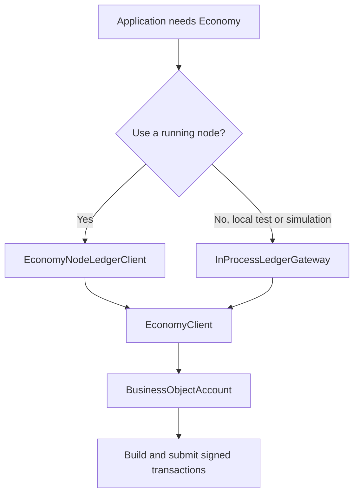

# Economy Developer Wiki

This is the code-first starting point for using CanDoItAll.Economy from an application. It focuses on SDK and driver usage, not UI integration.

## Where to Start

| Goal | Read |
| --- | --- |
| Understand ledger vocabulary before coding | [Ledger concepts](ledger-concepts.md) |
| Use a running Economy node from application code | [SDK quickstart](sdk-quickstart.md) |
| Build directly against the node HTTP driver | [Node driver](node-driver.md) |
| Run local simulations or tests without HTTP | [In-process driver](in-process-driver.md) |
| Extend simulator scenario packs, drivers, or GLB proof | [Generic Scenario Runtime v16](../simulation/generic-scenario-runtime-v16.md) |
| Understand the ledger/node internals | [Ledger and Node Guide](../LEDGER_NODE_GUIDE.md) |

## Driver Choice



## Main Code Surfaces

- `EconomyClient`: high-level facade for loading accounts, submitting transactions, reading balances/history, and message security helpers.
- `BusinessObjectAccount`: account-scoped operations such as payments, token transfers, BusinessObject create/update/transfer/close, and reads.
- `EconomyNodeLedgerClient`: HTTP driver that implements `ILedgerGateway` and `ILedgerReadClient`.
- `InProcessLedgerGateway`: local driver implementing the same gateway/read contracts without HTTP.
- `LedgerAccountContext`: `LedgerId` plus optional `ScenarioId`, used to isolate live and simulation states.
- `EconomyAccountKeyEnvelope`: portable account key envelope for loading SDK accounts.
- `IEconomyAccountHandler`: replaceable account refresh manager for starting/stopping refresh loops and observing new transactions.
- `AddEconomySdkWithNodeDriver(...)`: DI helper for node-driver applications.
- `AddEconomySdkWithGateway<TGateway>()`: DI helper for custom gateway/read-client implementations.

## Rules of Thumb

- Use `EconomyNodeLedgerClient` when a process owns the ledger node and your app should call it.
- Use `InProcessLedgerGateway` for tests, local simulations, and isolated domain workflows.
- Use `EconomyClient` and `BusinessObjectAccount` when you want account-oriented helpers.
- Use `ILedgerGateway` and `ILedgerReadClient` when you want to abstract over node and in-process drivers.
- Use `IEconomyAccountHandler` when an app needs account auto-refresh, new transaction events, or parent-routed subaccount events.
- Do not write directly to UTXO, spent-output, or projection tables as a business operation.

## Account Refresh Quick Example

```csharp
using ServiceProvider provider = new ServiceCollection()
    .AddEconomySdkWithNodeDriver(new Uri("https://node.example"))
    .BuildServiceProvider();

EconomyClient client = provider.GetRequiredService<EconomyClient>();
BusinessObjectAccount account = await client.LoadAccountAsync(context, keyEnvelope, cancellationToken);
IBusinessObjectCastRegistry castRegistry = provider.GetRequiredService<IBusinessObjectCastRegistry>();

client.AccountHandler.NewTransactionsObserved += (_, args) =>
{
    if (args.ParentAccount is not null)
    {
        Console.WriteLine($"Subaccount {args.SubAccount?.Name} saw {args.NewTransactions.Count} new transaction(s).");
    }
    else
    {
        Console.WriteLine($"{args.Account.Address} saw {args.NewTransactions.Count} new transaction(s).");
    }
};

await using IAccountRefreshHandle refresh = await client.AccountHandler.StartAutoRefreshAsync(
    account,
    castRegistry,
    new AccountRefreshOptions
    {
        Interval = TimeSpan.FromSeconds(5),
        IncludeTransactionData = true,
        MaxTransactionCount = 100
    },
    cancellationToken);

// Later, during shutdown or when the account is no longer visible:
await refresh.StopAsync(CancellationToken.None);
```

The first refresh is awaited before the handle is returned. By default, historical transactions from that baseline are not emitted as new; later refreshes emit only transactions whose `TxId` was not already seen. BusinessObject views are cached by their ledger-state key, so unchanged BOs keep the same view instance and custom casters are not called again.
