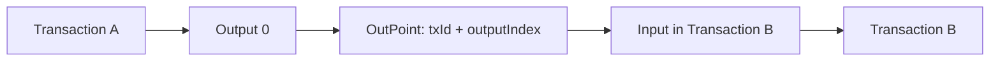

# Ledger Concepts for Developers

Read this before writing integration code. The same terms appear in the SDK, node driver, and ledger internals.

## Ledger and Scenario

`LedgerId` identifies a ledger. `ScenarioId` is optional and isolates a fork or simulation within the same logical ledger.

```csharp
var live = new LedgerAccountContext(new LedgerId("default"));
var simulation = new LedgerAccountContext(
    new LedgerId("default"),
    new ScenarioId("cashflow-sim-a"));
```

Balances, UTXOs, transactions, and projections are queried within the selected context.

## Transaction

`LedgerTransaction` is the submitted operation:

- `LedgerId` and optional `ScenarioId`;
- `Kind`: `Genesis`, `Mint`, `Transfer`, `BusinessObject`, or `Burn`;
- `SigningMode`: `Independent` or `Ordered`;
- ordered `Inputs`;
- ordered `Outputs`;
- optional `TransactionData`;
- optional calculated `TxId`, `TxHash`, and status.

`TxId` is calculated from canonical transaction core content. Signatures, signature payload hashes, stale client-supplied ids/hashes, status, and confirmation state are excluded from the core id. `TxHash` is the submitted-envelope hash, so it changes when signatures change.

## Input, Output, and OutPoint

An output is spendable value. An input spends a previous output.



The ledger also calculates an `OutPointKey` from ledger id, scenario id, previous tx id, output index, and address. That key indexes current UTXOs and spent outputs.

## UTXO

`UnspentOutput` is the current spendable set. It can hold:

- main ledger amount;
- optional token amount and token id;
- optional `BusinessObjectRef`;
- owner address;
- created timestamp.

When a transaction spends an output, it leaves the UTXO set and enters the spent-output index.

## Projection

`AddressBalanceProjection` and EF `AddressStateProjectionRecord` are read models. They are rebuilt from current UTXOs after touched addresses change.

Do not write projections to create business state. Submit transactions instead.

## BusinessObject

A BusinessObject is represented by a UTXO carrying a `BusinessObjectRef`:

- `ObjectId`;
- version;
- operation: `Create`, `Update`, `Transfer`, or `Close`;
- payload data hash.

Updating or transferring a BusinessObject spends the current object output and creates the next object output. The latest UTXO is the current owner/state pointer.

## Token

`TokenTransfer` is an optional output value with:

- `TokenId`;
- `Amount`.

Transfers conserve token balances. Minting new token types is policy controlled. Permission tokens can grant authority to mint token namespaces.

## Signature Payloads

Each input carries a signature bundle. The ledger rebuilds the expected payload hash based on signing mode and verifies:

- payload hash matches;
- signature is present;
- public key material derives the input address;
- public key hash matches;
- registered signature provider verifies the signature bytes.

## Ledger Entry Hash

After validation, the ledger creates a `ConfirmedTransaction` with:

- next ledger sequence;
- previous ledger hash;
- new ledger entry hash;
- admin signature;
- confirmation timestamp.

That creates a single-node tamper-evident hash chain.

## Common Developer Mistakes

- Submitting a non-genesis first transaction for a ledger/scenario.
- Trying to spend a BusinessObject that the account no longer owns.
- Building a token transfer from outputs that do not contain enough of that token.
- Reusing an already spent outpoint.
- Forgetting to include valid input signatures for non-genesis transactions.
- Treating projection rows as writable business state.
