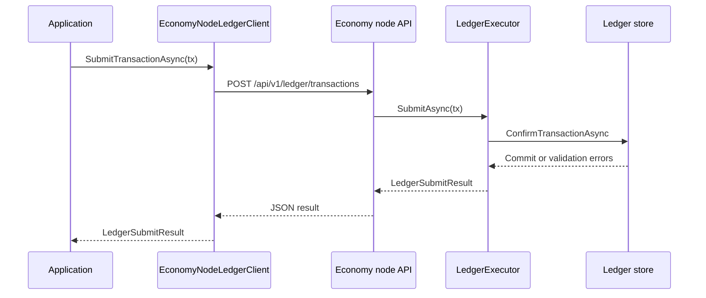

# Node Driver

Use the node driver when your application should talk to a running Economy node over HTTP.

## What the Driver Does

`EconomyNodeLedgerClient` implements:

- `ILedgerGateway.SubmitTransactionAsync`
- `ILedgerReadClient.GetSpendableOutputsAsync`
- `ILedgerReadClient.GetBalanceAsync`
- `ILedgerReadClient.GetBusinessObjectsAsync`
- `ILedgerReadClient.GetTransactionsAsync`

It also exposes `GetTransactionAsync(txId)` for node transaction details. Internally it maps those calls to node API routes, deserializes JSON, and raises `EconomyNodeRequestException` when the node returns a non-success HTTP status. The exception exposes `StatusCode`, `ResponseBody`, and parsed problem `title`/`detail` when the response follows problem-details JSON.

The driver uses versioned `/api/v1` routes by default. Legacy `/api` compatibility can still be selected with `EconomyNodeLedgerClientOptions.ApiBasePath = "api"` while old tools migrate.



## Basic Construction

In DI-based application startup:

```csharp
using CanDoItAll.Economy.Sdk;

services.AddEconomySdkWithNodeDriver(new Uri("http://localhost:5000/"));
```

To configure the API base path, write API key, or JWT bearer token:

```csharp
services.AddEconomySdkWithNodeDriver(
    new Uri("https://economy-node.internal/"),
    options =>
    {
        options.ApiBasePath = "api/v1";
        options.ApiKeyHeaderName = "X-CDA-Economy-Key";
        options.ApiKey = configuration["Economy:Api:Key"];
        options.BearerToken = configuration["Economy:Api:BearerToken"];
    });
```

When `BearerToken` is set, the driver sends `Authorization: Bearer <token>` and does not send the API-key header. Leave `BearerToken` empty for API-key-only deployments.

For direct construction:

```csharp
using CanDoItAll.Economy.Sdk;

using var driver = new EconomyNodeLedgerClient(
    new Uri("http://localhost:5000/"),
    new EconomyNodeLedgerClientOptions { ApiBasePath = "api/v1" });
```

You can also pass an existing `HttpClient` with `BaseAddress` set:

```csharp
var httpClient = new HttpClient
{
    BaseAddress = new Uri("https://economy-node.internal/")
};

using var driver = new EconomyNodeLedgerClient(httpClient);
```

When you pass your own `HttpClient`, you own its lifetime.

## Reading Through the Driver

```csharp
var query = new LedgerAddressQuery(
    new LedgerAccountContext(new LedgerId("default")),
    accountAddress);

IReadOnlyList<LedgerSpendableOutput> outputs =
    await driver.GetSpendableOutputsAsync(query, cancellationToken);

LedgerAccountBalance balance =
    await driver.GetBalanceAsync(query, cancellationToken);
```

`GetBalanceAsync` currently calculates balance from spendable outputs returned by the node driver.

For transaction details:

```csharp
EconomyNodeTransactionDetails? details =
    await driver.GetTransactionAsync(txId, cancellationToken);
```

## Submitting Through the Driver

```csharp
LedgerSubmitResult result = await driver.SubmitTransactionAsync(
    signedTransaction,
    cancellationToken);
```

The submitted transaction should already carry the expected input signatures. The node validates signatures, input ownership, double-spend rules, policy rules, and conservation before confirming it.

## Node Host in Code

For local processes, `EconomyNodeHost` can build and initialize a node:

```csharp
using CanDoItAll.Economy.Node;
using Microsoft.AspNetCore.Builder;

WebApplicationBuilder builder = EconomyNodeHost.CreateBuilder(args, options =>
{
    options.PersistenceProvider = EconomyNodePersistenceProvider.InMemory;
    options.InMemoryDatabaseName = "economy-dev";
});

await using WebApplication app = EconomyNodeHost.Build(builder);
await EconomyNodeHost.InitializeAsync(app.Services, cancellationToken);
await app.RunAsync(cancellationToken);
```

For PostgreSQL, configure `PersistenceProvider`, `PostgreSqlConnectionString`, and optionally `PostgreSqlMigrationsAssembly`.

To require a simple write API key for mutating node endpoints:

```csharp
options.ApiSecurityMode = EconomyNodeApiSecurityMode.RequireApiKey;
options.ApiKey = builder.Configuration["Economy:Api:Key"];
```

To require JWT bearer auth for API reads and writes:

```csharp
options.ApiSecurityMode = EconomyNodeApiSecurityMode.RequireJwtBearer;
options.ReadSecurityMode = EconomyNodeApiReadSecurityMode.RequireJwtBearer;
options.AuthPersistenceProvider = EconomyNodeAuthPersistenceProvider.PostgreSql;
options.AuthPostgreSqlConnectionString = builder.Configuration["Economy:Auth:PostgreSql:ConnectionString"];
options.JwtSigningKey = builder.Configuration["Economy:Auth:Jwt:SigningKey"];
```

The browser console can be protected separately with `UiAuthMode = EconomyNodeUiAuthMode.Cookie`; that cookie does not authorize API requests when the API mode requires JWT.

To use a configured ledger-admin signer instead of the development signer:

```csharp
options.LedgerAdminAccount = EconomyNodeAdminAccount.FromText(
    SignatureAlgorithmId.EcdsaP256Sha256,
    keyId: "node-ledger-admin",
    publicKeyMaterial: publicKeyBase64,
    privateKeyMaterial: privateKeyBase64);
```

Do not expose the API key or private key through bootstrap, logs, or database records.

For VPS hosting, reverse proxy, data-protection, and JWT rotation guidance, see `docs/VPS_HOSTING.md`.

## When to Use It

- Multiple application processes need the same ledger state.
- You want node-owned persistence, treasury bootstrap, and policy enforcement behind an API.
- You want to swap application clients without embedding the ledger executor in every process.

## Boundaries

- The driver is not a general HTTP wrapper for every node helper endpoint. It implements the ledger gateway/read contracts.
- Treasury helper endpoints such as mint or permission grants are node operations, not account SDK operations.
- The driver observes cancellation tokens but does not add automatic retries to mutating calls. Add retry/idempotency only after the write contract has an idempotency key.
- Direct database writes remain outside the supported business operation path.
