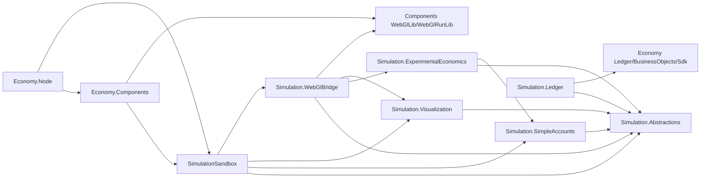

# Economy Simulation Architecture Boundaries

The simulation subsystem is a layered set of contracts, backends, projection adapters, and host services. The layers keep ledger persistence, UI, and WebGL separated so future simulators can reuse the generic rendering packages without leaking Economy semantics into Components.

The simulator is a bounded simulation and experimental-economics framework, not a universal economic oracle.

## Dependency Diagram

## Package Map

| Project | Role | Allowed dependencies | Boundary rule |
| --- | --- | --- | --- |
| `CanDoItAll.Economy.Simulation.Abstractions` | Backend-neutral run, frame, scenario, experiment, snapshot, analysis, and backend contracts. | None in the current project file. | No Ledger, BusinessObjects, SDK, Components, WebGL, or UI references. |
| `CanDoItAll.Economy.Simulation.ExperimentalEconomics` | Smith-style laboratory contracts and services: induced values, environment/institution/outcome definitions, market mechanisms, sessions, payoff journals, metrics, treatment replication, and agent-policy baselines. | `Simulation.Abstractions`, `Simulation.SimpleAccounts`. | Economic evidence stays headless and protocol-backed. No Components, WebGL, UI, Ledger persistence, Node, or EF references. |
| `CanDoItAll.Economy.Simulation.SimpleAccounts` | Lightweight in-memory scenario backend and transition/event handling for account-style demos and tests. | `Simulation.Abstractions`. | No ledger persistence, Components, WebGL, or Node hosting concerns. |
| `CanDoItAll.Economy.Simulation.Visualization` | Economy visual DTOs and frame/action mappers. | `Simulation.Abstractions`. | Emits economy visual DTOs only; no Components or WebGL types. |
| `CanDoItAll.Economy.Simulation.Ledger` | Ledger-backed simulation preparation. | `Simulation.Abstractions`, `Economy.Ledger`, `Economy.BusinessObjects`, `Economy.Sdk`. | Ledger coupling stays here and does not flow into SimpleAccounts or Visualization. |
| `CanDoItAll.Economy.Simulation.WebGlBridge` | Adapter from economy visual frames/actions to generic Components WebGL scene/run documents. | `Simulation.Abstractions`, `Simulation.Visualization`, `Simulation.ExperimentalEconomics`, and WebGL packages/project refs. | Economy-specific mapping lives here; browser observer evidence cannot replace headless economic evidence. Components receive only generic WebGL scene/run types and `source.*` provenance metadata. |
| `CanDoItAll.Economy.SimulationSandbox` | Application service layer for scenario catalogs, backend selection, session state, visualization, WebGL projection, snapshots, scenario suites, stress campaigns, and evidence artifacts. | `Simulation.Abstractions`, `SimpleAccounts`, `Visualization`, `WebGlBridge`. | Host orchestration belongs here; it should not be copied into Components packages. |
| `CanDoItAll.Economy.Components` | Blazor UI for Economy workspace and simulation sandbox. | Economy domain projects, `SimulationSandbox`, Components Base/Charts/Mermaid, and WebGL packages/project refs when sandbox visualization is enabled. | UI can present Economy concepts, but shared Components packages stay domain-neutral. |
| `CanDoItAll.Economy.Node` | Node-hosted Economy runtime and browser sandbox route. | Economy domain projects, persistence, `SimulationSandbox`, and UI support packages. | Registers app-owned scenario catalogs and serves runtime assets; it is not a generic Components dependency. |

## Public Surfaces

| Surface | Location | Use |
| --- | --- | --- |
| `ISimulationBackend`, `ISimulationRunFactory`, `ISimulationRunFrameProvider`, `ISimulationFrameProjector`, `ISimulationEventMaterializer` | `Simulation.Abstractions/Backends` | Add a backend or expose frame/run materialization without coupling to UI or WebGL. |
| `SimulationScenarioDefinition`, `SimulationFrame`, `SimulationFrameDelta`, `SimulationRunSnapshot`, `ISimulationSnapshotStore`, `IAsyncSimulationSnapshotStore` | `Simulation.Abstractions` | Share scenarios, frame output, snapshot persistence, and replay/export data. |
| `SimulationExperimentInputPackLoader`, `SimulationExperimentInputPackValidator`, `ISimulationInputGenerator` | `Simulation.Abstractions/Experiment` | Load, validate, or generate deterministic experiment inputs. |
| `ISimulationSnapshotAnalysisService`, `ISimulationSnapshotAnalyzer`, `ISimulationSnapshotAnalysisFacet` | `Simulation.Abstractions/Snapshot` | Add analysis facets without changing backend or UI code. |
| `IEconomyVisualFrameMapper`, `IEconomyVisualActionMapper`, economy visual DTOs | `Simulation.Visualization` | Convert backend frames into Economy visual nodes, links, layers, and action timelines. |
| `IEconomyWebGlRunProjector`, `IEconomyVisualActionWebGlMapper`, `EconomyWebGlRunValidator`, projection diagnostics | `Simulation.WebGlBridge` | Convert economy visual data to generic WebGL run documents and validate projection output. |
| `InducedValueProtocol`, `MicroeconomicSystemDefinition`, `IMarketInstitutionMechanism`, `ExperimentSession`, `SubjectPayoffJournal`, `SmithMarketOutcomeReport`, `MechanismComparisonCampaign` | `Simulation.ExperimentalEconomics` | Build and validate Smith-style laboratory contracts without coupling to UI or persistence. |
| `IEconomySimulationScenarioCatalog`, `IEconomySimulationBackendRegistry`, `IEconomySimulationBackendSelector`, `IEconomyVisualizationPipeline`, `IEconomyWebGlProjectionPipeline`, `IEconomySnapshotPipeline` | `SimulationSandbox` | Compose app-owned scenario catalogs, backend selection, visualization, WebGL projection, and snapshot handling for hosts. |

## Product Runtime Rules

- Driver behavior is resolved through `IEconomicSimulationDriverRegistry` and `EconomicSimulationDriverRegistration`.
- Scenario packs are resolved through source manifests and catalogs, so generic execution sees source ids rather than concrete host folder names.
- Scenario suites and stress campaigns are manifest-driven product contracts.
- Real scenario-pack rows export frame, delta, metric, invariant, WebGL, and per-scenario artifacts; WebGL rows remain visualization-only.
- Memory-economy attention allocation lives in the explicit `Simulation.MemoryEconomy` extension and is not part of the default generic simulator, Smith core, or default scenario matrix.
- GLB pose and symbol selection lives in Economy-side WebGL bridge mapping and catalog code; Components receive generic WebGL scene/run documents.

## Browser Observer Contract

The browser observer layer complements headless scenario evidence. It can validate that the current browser runtime renders projected generic WebGL documents, but it cannot close economic correctness by itself.

| Surface | Required evidence | Failure mode |
| --- | --- | --- |
| Initial scene | Runtime-ready diagnostics with positive object and visible-object counts, plus a screenshot of the WebGL canvas. | Empty canvas, missing labels/objects, or missing runtime diagnostics. |
| Frame apply | Runtime snapshot after apply, applied frame index, zero runtime errors, and visible objects. | Fake success flag, missing runtime snapshot, or runtime error. |
| State progression | Step/seek diagnostics showing a new frame or applied motion/stage counts, plus screenshot evidence. | DOM-only evidence without screenshot or no frame/action progression. |
| Runtime cleanup | Pause/stop diagnostics showing stop reason, successful stop, cleared motions, and zero active/queued motions after cleanup. | Active/queued runtime work remains after Pause, or cleanup silently fails. |

## Host And Package Readiness

- Local development can use sibling project references to Components.
- Package-consumption validation should use a fresh local feed, an isolated package cache, and explicit package-mode properties documented in the root README.
- Node-hosted scenarios belong under the Node runtime content root and are exposed through `IEconomySimulationScenarioCatalog`.
- Runtime scenario catalogs expose pathless descriptors and scenario sources.
- Runtime scenario manifests lock every required file through `fileHashes` and lock the complete required-file set through `packHash`.
- WebGL projection output carries Economy provenance as `source.*` metadata only.
- Browser replay uses full reset replay for manual/seek/load/back/recovery paths and reserves incremental replay for contiguous forward steps from a known stable browser frame.
- Pause/Cancel/Stop handling must cancel host-side work and call the Components WebGL runtime stop path.

## Reuse Guidance

Future production-line simulators, non-economy visualizations, or other domain engines should follow this shape:

1. Keep domain contracts and transition rules in the consuming domain repository.
2. Map domain frames into domain-owned visual DTOs or directly into `WebGlSceneModel` and `WebGlRunDocument`.
3. Use Components `WebGlLib` and `WebGlRunLib` as generic rendering/playback packages.
4. Put domain-specific symbols, action mapping, validation, and provenance interpretation in the consuming domain bridge, not in Components.
5. Use `source.*` metadata for traceability and keep generic validators focused on generic scene/run correctness.

## Guardrails

- Shared simulation contracts do not reference Ledger, BusinessObjects, SDK, Components, or WebGL.
- Smith experimental-economics contracts do not reference Components, WebGL, Ledger persistence, Node, EF, or UI projects.
- Simple-account scenario seeds do not use Ledger, BusinessObjects, SDK, Components, or WebGL.
- Visualization contracts use economy visual DTOs only.
- Ledger-backed simulation prep stays in the dedicated `Simulation.Ledger` project.
- WebGL bridge references generic WebGL packages but does not push Economy semantics into Components packages.
- Components and Node may host Economy UI and runtime scenario catalogs, but they are app/host layers rather than simulation primitives.
